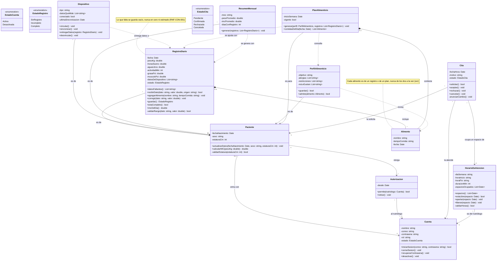
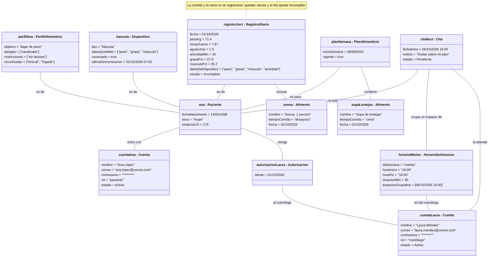

# Diagrama de clases · NutriGo!

| Campo | Valor |
|---|---|
| **Sistema** | NutriGo! |
| **Autor** | Diego Valdovinos Rodríguez |
| **Versión** | 1.1 |
| **Fecha** | 17/11/2026 |
| **Fuentes** | `docs/clases-candidatas.md`, `docs/especificacion-requisitos.md` |

Los diagramas van como texto de Mermaid, igual que los de la unidad pasada. Para verlos, pega cada bloque en [mermaid.live](https://mermaid.live). Las clases son las once que quedaron en `docs/clases-candidatas.md`, con lo que sabe cada una como atributos y lo que hace como operaciones.

La versión 1.1 es la que quedó después de poner a trabajar el diagrama con la secuencia, las máquinas de estados y los paquetes. Lo que cambió y por qué está al final, en [Cambios de la versión 1.1](#4--cambios-de-la-versión-11).

---

## 1 · Diagrama de clases

Los atributos son privados y las operaciones públicas, salvo las que solo usa la propia clase. Los tipos salen de la especificación: la estatura va en centímetros como pide el RF-001, y los rangos de peso, sueño, agua y actividad son los del RNF-CON-002. Los tres atributos de estado usan una enumeración cuyos valores son exactamente los estados de su máquina en [estados-y-actividad.md](estados-y-actividad.md).

### Cómo se lee cada multiplicidad

La multiplicidad va en el extremo que describe y se lee cruzado. Estas son en voz alta, que es como se revisa que ninguna esté al revés:

| Relación | Se lee |
|---|---|
| Paciente `"0..1"` → `"1"` Cuenta | Cada paciente entra con exactamente una cuenta, y una cuenta es de cero o un paciente: la del nutriólogo y la del administrador no tienen paciente. |
| Paciente `"1"` → `"*"` Autorizacion | Un paciente puede autorizar a varios nutriólogos, y cada autorización la dio un solo paciente. |
| Autorizacion `"*"` → `"1"` Cuenta | Cada autorización es para exactamente un nutriólogo, y un nutriólogo puede tener muchas. |
| RegistroDiario `"*"` → `"1"` Paciente | Cada registro diario es de exactamente un paciente, y un paciente tiene muchos registros. |
| Dispositivo `"*"` → `"1"` Paciente | Cada dispositivo es de exactamente un paciente, y un paciente vincula cero o muchos. |
| ResumenMensual `"*"` → `"1"` Paciente | Cada resumen es de exactamente un paciente, y un paciente conserva uno por cada mes que ya pasó de 30 días. |
| PerfilAlimenticio `"0..1"` → `"1"` Paciente | Cada perfil es de exactamente un paciente, y un paciente tiene cero o un perfil, porque al crear la cuenta todavía no registra sus preferencias (RF-016). |
| PlanAlimenticio `"*"` → `"1"` Paciente | Cada plan es para exactamente un paciente, y un paciente recibe un plan por semana, así que muchos. |
| Cita `"*"` → `"1"` Paciente | Cada cita la solicitó exactamente un paciente, y un paciente solicita muchas citas. |
| Cita `"*"` → `"1"` Cuenta | Cada cita la atiende exactamente un nutriólogo, y un nutriólogo atiende muchas citas. |
| Cita `"*"` → `"1"` HorarioDeAtencion | Cada cita ocupa un espacio de exactamente un horario, y un horario tiene muchas citas. |
| HorarioDeAtencion `"*"` → `"1"` Cuenta | Cada horario es de exactamente un nutriólogo, y un nutriólogo registra muchos horarios. |
| RegistroDiario `"0..1"` ◆ `"*"` Alimento | Un registro incluye muchos alimentos, y cada alimento está en cero o un registro. |
| PlanAlimenticio `"0..1"` ◆ `"*"` Alimento | Un plan contiene muchos alimentos, y cada alimento está en cero o un plan. |

### Por qué cada relación es la que es

**Composición.** Solo en dos lugares, donde la parte de verdad no tiene sentido sin el todo y no se comparte:
- **RegistroDiario y Alimento.** La avena del desayuno del 1 de octubre solo existe dentro de ese registro.
- **PlanAlimenticio y Alimento.** La sopa de lentejas planeada para el jueves solo existe dentro de ese plan.

**Asociación.** Todo lo demás, y todas con flecha. La flecha sale siempre del lado de "muchos" hacia el dueño: el registro sabe de qué paciente es, pero el paciente no guarda la lista de sus registros. Hay dos razones:
- Es la decisión de la Actividad 1 para el modelo de inquilinos todo compartido: cada dato va marcado con el paciente al que pertenece, y así se filtra.
- Con la flecha al revés, Cuentas dependería de los otros tres módulos y los otros tres de Cuentas, y el diagrama de paquetes quedaría con ciclos. Se explica en [paquetes-y-componentes.md](paquetes-y-componentes.md).

Por ejemplo, la cita guarda a qué horario pertenece, pero el horario del martes existía antes de esa cita y sigue después, así que ninguna es parte de la otra.

**Dependencia.** Para las clases que se reciben como parámetro y se sueltan, sin guardarlas en un atributo:
- El dispositivo recibe el registro en `entregarDatos(registro)`.
- El perfil revisa un alimento en `admite(alimento)`.
- El plan recibe el perfil y los registros en `generar(perfil, registros)`.
- El resumen recibe los registros en `generar(registros)`.

Las dependencias no llevan multiplicidad. No hay una referencia guardada que contar, igual que en el `Cobros ..> Calculadora` de la clase.

**Enumeración.** `EstadoCuenta`, `EstadoRegistro` y `EstadoCita` no se unen con línea a su clase: son el tipo de un atributo, igual que `Date` o `string`. Sus valores son los estados de cada máquina, ni uno más ni uno menos.

**Herencia y realización.** No aparecen. Con las clases candidatas, ningún par pasa la prueba de "todo A es un B", y ninguna es una interfaz.

Las reglas que la notación no alcanza a decir van en notas: la del alimento que pertenece a un registro o a un plan, y la de no rellenar con cero lo que falta.

---

## 2 · Diagrama de objetos

El caso es el de Ana López, la paciente del prototipo, el jueves 1 de octubre de 2026:
- Se pesó en la báscula: 72.4 kg.
- Corrigió su sueño a 7 h 40 min.
- Registró la avena del desayuno y guardó sin capturar la comida ni la cena.
- Tiene su plan de la semana del 28 de septiembre.
- Pidió una cita para el martes 6 de octubre a las 16:00 con la Lic. Laura Méndez y la autorizó a ver su progreso.

Mermaid no tiene diagrama de objetos, así que se dibuja con `classDiagram`:
- Cada caja lleva el nombre con el formato `objeto : Clase`, como etiqueta.
- Los atributos llevan su valor con `=`.
- Las líneas entre objetos son enlaces y no llevan multiplicidad, porque cada una une a dos objetos concretos.
- En UML el nombre del objeto va subrayado, pero Mermaid no puede subrayarlo.

### Lo que comprueba

El diagrama de clases sí puede representar el caso, y cada multiplicidad se cumple:

- **cuentaLaura no tiene ningún paciente.** Por eso la multiplicidad de Paciente hacia Cuenta es `"0..1"` y no `"1"`.
- **La avena está en un registro y en ningún plan, y la sopa de lentejas al revés.** Las dos cumplen el `"0..1"` y la nota de que cada alimento pertenece a un registro o a un plan, nunca a los dos.
- **La cita, el horario y la autorización apuntan a la misma cuenta de Laura.** Sin una clase Nutriólogo aparte, la cuenta con su rol alcanza para atender citas, registrar horarios y recibir el permiso.
- **El 7.67 de horasSueno es la corrección a mano de 7 h 40 min.** Por eso "sueño" no aparece en `datosDeDispositivo`: cuando el paciente corrige un dato, su valor se queda y deja de contar como dato del dispositivo (RF-010).
- **La cita del 6 de octubre a las 16:00 aparece en los `espaciosOcupados` del horario.** Así otro paciente no puede pedir ese espacio (RF-020).
- **Los estados son valores de su enumeración.** `Activa` es de `EstadoCuenta`, `Incompleto` de `EstadoRegistro` y `Pendiente` de `EstadoCita`, por eso van sin comillas.

**Lo que encontró el caso.** Al llenar la sopa de lentejas del plan faltaba un dato: el plan tiene comidas por día, pero Alimento solo sabía su nombre y su tiempo de comida, así que no había forma de saber que la sopa es del jueves. Le agregué la `fecha` a Alimento. En el registro es el día que se comió y en el plan es el día para el que está planeado. Sin ese atributo, `comidasDelDia(fecha)` no tendría con qué filtrar. Es justo el error de diseño que este diagrama sirve para encontrar antes de programar.

---

## 3 · Dudas para discutir en clase

- **Paciente y RegistroDiario, ¿composición o asociación?** Los registros son de un solo paciente y no tienen sentido sin él, lo que apunta a composición. Lo dejé como asociación porque el RF-029 dice que al desactivar una cuenta su información se conserva, y porque a los 30 días los registros se sustituyen por el resumen mensual (RF-027): su vida no la decide solo el paciente.
- **Alimento como una sola clase para el registro y para el plan.** Funciona con la multiplicidad `"0..1"` en los dos lados y la nota {xor}, pero obliga a esa nota. La alternativa es partirla en dos clases, una para lo que se comió y otra para lo que se planeó, como ya están separadas en el modelo de datos de `diagramas.md`.
- **Cuenta con todos los roles.** La cita, el horario y la autorización apuntan a Cuenta, y el diagrama no impide que la cuenta de un administrador atienda una cita. Esa regla hoy la cuida el rol (RNF-SEG-003), no la estructura.

---

## 4 · Cambios de la versión 1.1

Lo que le faltaba al diagrama de la versión 1.0, encontrado al dibujar los diagramas de comportamiento y los paquetes. El detalle de cada hallazgo está en [consistencia.md](consistencia.md).

| Cambio | Lo encontró | Por qué |
|---|---|---|
| `+datosFaltantes() List~string~` en RegistroDiario | Diagrama de secuencia | La app tiene que mostrar qué falta por registrar (CU-07, paso 2) y ninguna operación lo contestaba. |
| `+agregarAlimento(nombre, tiempoComida)` en RegistroDiario | Diagrama de secuencia | El registro se compone de sus alimentos, así que le toca crearlos (Creador, de GRASP), pero no tenía cómo recibirlos. |
| `recibirDato(...)` devuelve `bool` | Diagrama de secuencia | La app necesita saber si el valor se aceptó o quedó fuera de rango (RNF-CON-002). |
| `guardar()` devuelve `EstadoRegistro` | Diagrama de secuencia | Después de guardar, la app muestra si el día quedó Completo o Incompleto (CU-07, paso 8). |
| `estado: EstadoRegistro` y su enumeración | Máquina de estados | El estado era un `string` libre; ahora solo admite los tres estados del diagrama. |
| `estado: EstadoCita` y su enumeración | Máquina de estados | Igual que el registro: la cita tiene cuatro estados en la especificación y el `string` admitía cualquier cosa. |
| `estado: EstadoCuenta` y su enumeración | Máquina de estados | La cuenta solo puede estar Activa o Desactivada (RF-029). |
| Las asociaciones con Paciente ahora salen del otro extremo | Diagrama de paquetes | Con Paciente apuntando a todo, Cuentas dependía de los otros tres módulos y había ciclos. |
| Paciente y PerfilAlimenticio pasaron de composición a asociación | Diagrama de paquetes | La composición obligaba a Paciente a guardar su perfil, otra vez Cuentas dependiendo de Plan alimenticio. |
| HorarioDeAtencion y Cuenta dejaron de ser bidireccionales | Diagrama de paquetes | Era el único lazo en los dos sentidos entre Consultas y Cuentas. |
| ResumenMensual ya no incluye los planes ni tiene `descargarPDF()` | Diagrama de paquetes | El resumen vive en Seguimiento y los planes en Plan alimenticio, que ya depende de Seguimiento. Que el resumen conociera los planes cerraba un ciclo. El PDF del RF-026 lo arma la app con lo que le dan los dos módulos. |
