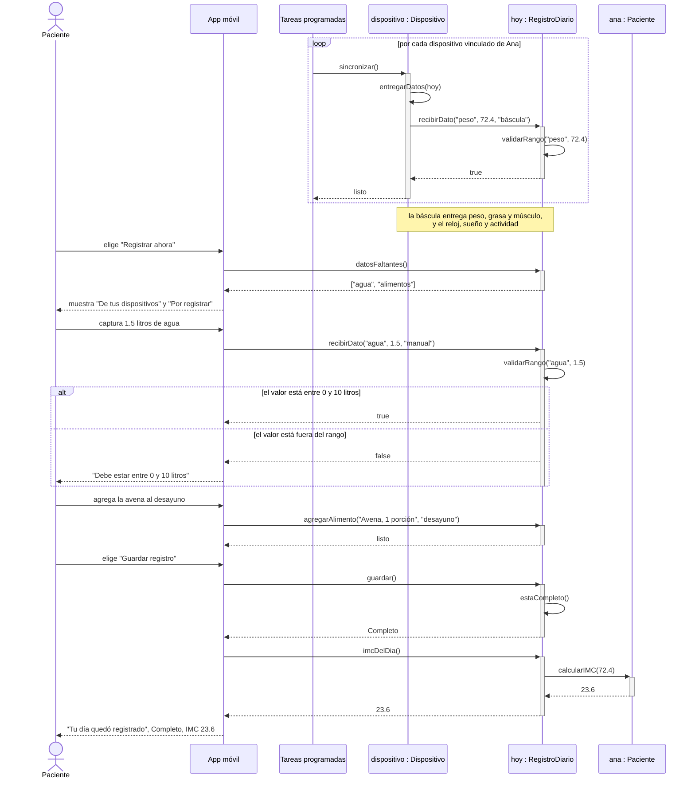

# Diagrama de secuencia · NutriGo!

| Campo | Valor |
|---|---|
| **Sistema** | NutriGo! |
| **Autor** | Diego Valdovinos Rodríguez |
| **Versión** | 1.0 |
| **Fecha** | 17/11/2026 |
| **Fuentes** | `docs/casos de uso/cu-07.md`, `docs/arch/diagrama-de-clases.md` |

## El escenario que elegí

**CU-07 · Registrar el seguimiento diario** (RF-007, RF-008, RF-012, RNF-CON-002). Es el caso de uso que, si falla, deja sin sentido a todo lo demás: el progreso, el IMC, el ajuste del plan de cada lunes y lo que ve el nutriólogo salen de los registros del día. Sin registro no hay nada que mostrar.

El escenario es el del RF-007, con los datos de Ana:
- En la mañana sus dispositivos se sincronizan y el registro de hoy recibe el peso de 72.4 kg de la báscula y el sueño y la actividad del reloj.
- Ana abre el registro, captura 1.5 litros de agua y la avena del desayuno, y guarda.
- El día queda Completo con un IMC de 23.6.

Las columnas son objetos de las clases del diagrama de clases, más la app y las tareas programadas, que son contenedores del nivel 2 de C4 y no clases.

## Diagrama

### Cómo se lee

- **El tiempo baja.** Lo primero que pasa ocurre antes de que Ana abra la app: las tareas programadas sincronizan cada dispositivo vinculado. Por eso el peso ya está en el registro cuando ella entra, que es lo que pidió en la entrevista.
- **Las barras de activación** marcan el rato en que cada objeto está trabajando. La de `hoy` en `guardar()` es más larga porque, mientras guarda, revisa si el día está completo.
- **El único `alt` es el valor fuera de rango.** Es el fracaso que de verdad importa en este escenario: un valor equivocado, como 724 en lugar de 72.4, cambia la gráfica, el IMC y el plan de la siguiente semana (RNF-CON-002). Los demás caminos del CU-07, como guardar el día incompleto o corregir un dato, van en su propio caso de uso y no se meten aquí.
- **La validación vive en el registro, no en el dispositivo.** El mismo `validarRango()` revisa el dato que llega de la báscula y el que captura Ana. Es la decisión de la Actividad 1: el registro es el que decide qué acepta.

## La regla de oro, mensaje por mensaje

Cada mensaje que entra en un objeto tiene que ser una operación de su clase. Los mensajes que llegan a la app y a las tareas programadas no cuentan, porque no son clases.

| Mensaje | Lo recibe | ¿Estaba en el diagrama de clases 1.0? |
|---|---|---|
| `sincronizar()` | Dispositivo | Sí |
| `entregarDatos(hoy)` | Dispositivo | Sí |
| `recibirDato("peso", 72.4, "báscula")` | RegistroDiario | Sí, pero devolvía `void` y aquí tiene que contestar si aceptó el valor |
| `validarRango(...)` | RegistroDiario | Sí, privada, y aquí la llama el propio registro |
| `datosFaltantes()` | RegistroDiario | **No** |
| `recibirDato("agua", 1.5, "manual")` | RegistroDiario | Sí, con el mismo problema del `void` |
| `agregarAlimento("Avena, 1 porción", "desayuno")` | RegistroDiario | **No** |
| `guardar()` | RegistroDiario | Sí, pero devolvía `void` y la app necesita saber en qué estado quedó el día |
| `estaCompleto()` | RegistroDiario | Sí |
| `imcDelDia()` | RegistroDiario | Sí |
| `calcularIMC(72.4)` | Paciente | Sí. El registro puede llamarlo porque la asociación va de RegistroDiario a Paciente |

## Lo que le faltaba al diagrama de clases

Cinco cosas. Ya están corregidas en la versión 1.1 de [diagrama-de-clases.md](diagrama-de-clases.md):

1. **`datosFaltantes()`.** El paso 2 del CU-07 muestra "Por registrar" con lo que falta, y ninguna clase sabía contestarlo. Le toca al registro, porque es quien tiene los datos (Experto en información).
2. **`agregarAlimento(nombre, tiempoComida)`.** RegistroDiario se compone de sus alimentos, pero no tenía cómo recibirlos. Como los contiene, le toca crearlos (Creador).
3. **`recibirDato()` tiene que devolver `bool`.** Sin respuesta, la app no puede mostrar el rango permitido cuando el valor no se acepta, y el `alt` no tendría con qué decidir.
4. **`guardar()` tiene que devolver el estado.** La pantalla de confirmación dice "Completo" o "Incompleto", y antes nadie se lo decía a la app.
5. **El estado tenía que ser una enumeración.** La respuesta de `guardar()` es `Completo`, y con un `string` cualquier palabra valía. Esto lo confirmó después la máquina de estados.
