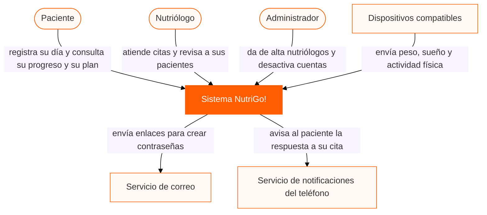
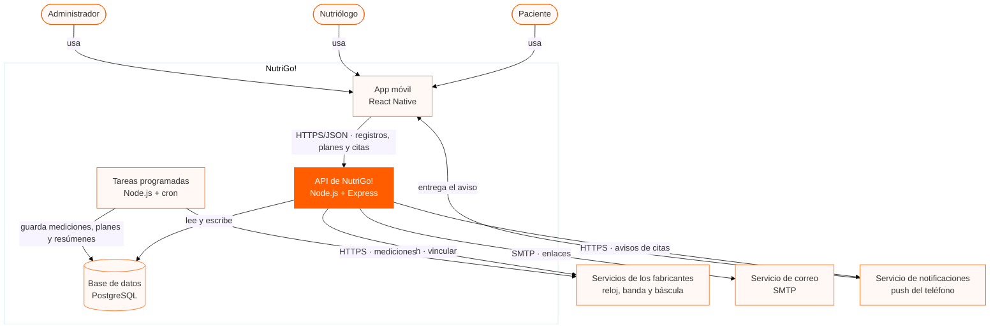
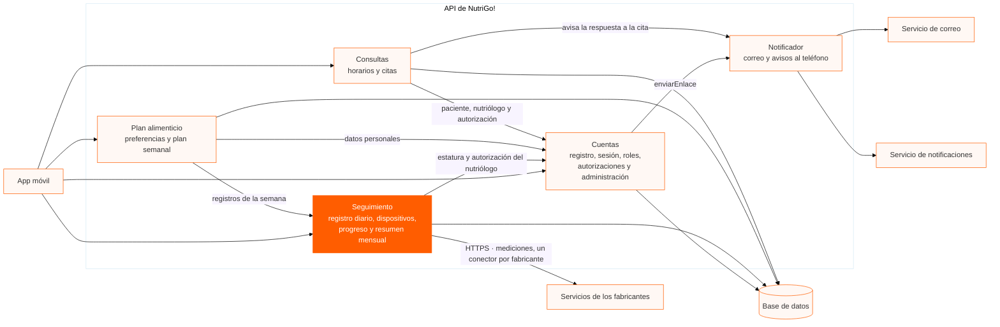
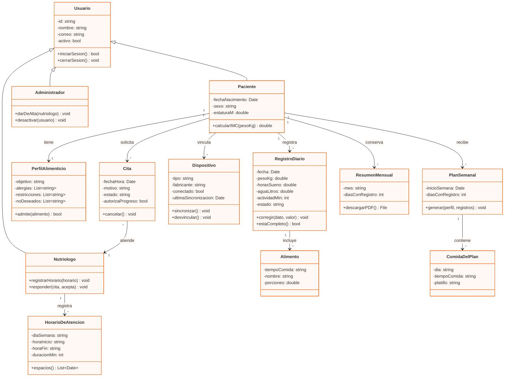
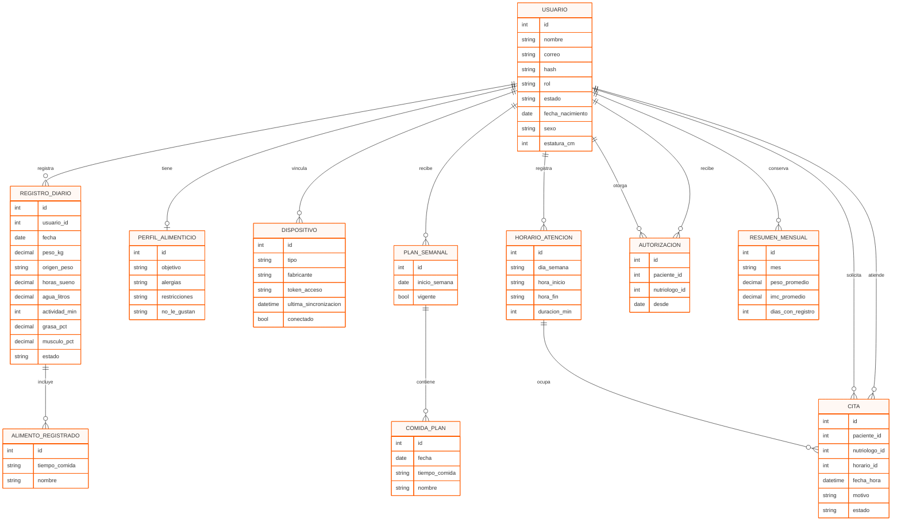

# Diagramas de arquitectura · NutriGo!

| Campo | Valor |
|---|---|
| **Sistema** | NutriGo!  |
| **Autor** | Diego Valdovinos Rodríguez |
| **Versión** | 1.1 |
| **Fecha** | 17/11/2026 |
| **Fuentes** | `docs/vision-del-producto.md`, `docs/especificacion-requisitos.md` |

Los diagramas van como texto de Mermaid, igual que el código: se comparan entre versiones y se revisan en el mismo diff. Para verlos, pega cada bloque en [mermaid.live](https://mermaid.live).

## Dónde está cada diagrama

| Diagrama | Tipo | Archivo |
|---|---|---|
| Casos de uso | UML, comportamiento | `docs/diagramas/casos-de-uso.drawio` y sus PNG |
| C4 nivel 1 · Contexto | C4 | [Sección 1](#1--nivel-1--diagrama-de-contexto) de este archivo |
| C4 nivel 2 · Contenedores | C4 | [Sección 2](#2--nivel-2--diagrama-de-contenedores) de este archivo |
| C4 nivel 3 · Componentes | C4 | [Sección 3](#3--nivel-3--diagrama-de-componentes) de este archivo |
| Clases | UML, estructural | [diagrama-de-clases.md](diagrama-de-clases.md), sección 1 |
| Objetos | UML, estructural | [diagrama-de-clases.md](diagrama-de-clases.md), sección 2 |
| Paquetes | UML, estructural | [paquetes-y-componentes.md](paquetes-y-componentes.md), sección 1 |
| Componentes | UML, estructural | [paquetes-y-componentes.md](paquetes-y-componentes.md), sección 2 |
| Secuencia · Registrar el seguimiento diario | UML, comportamiento | [diagrama-de-secuencia.md](diagrama-de-secuencia.md) |
| Estados · Registro diario, Cita y Cuenta | UML, comportamiento | [estados-y-actividad.md](estados-y-actividad.md), secciones 1 a 3 |
| Actividad · Registrar el seguimiento diario | UML, comportamiento | [estados-y-actividad.md](estados-y-actividad.md), sección 4 |
| Modelo de datos | Entidad-relación | [Sección 8](#8--modelo-de-datos) de este archivo |
| Revisión de consistencia entre todos | Taller | [consistencia.md](consistencia.md) |

## Registros de decisión

| # | Decisión | Archivo |
|---|---|---|
| ADR-001 | Monolito modular con cuatro módulos | [adr-001-monolito-modular.md](adr-001-monolito-modular.md) |
| ADR-002 | Software como servicio con multi-tenancy todo compartido | [adr-002-multi-tenancy-todo-compartido.md](adr-002-multi-tenancy-todo-compartido.md) |
| ADR-003 | Tareas programadas en un proceso aparte | [adr-003-tareas-programadas.md](adr-003-tareas-programadas.md) |
| ADR-004 | Datos de los dispositivos por el servicio de cada fabricante, con un conector por fabricante | [adr-004-datos-de-dispositivos.md](adr-004-datos-de-dispositivos.md) |
| ADR-005 | El informe en PDF lo arma la app | [adr-005-informe-pdf-en-la-app.md](adr-005-informe-pdf-en-la-app.md) |

---

## 1 · Nivel 1 · Diagrama de contexto

El sistema completo visto desde afuera: quién lo usa y con quién habla. No aparece ninguna tecnología a propósito, porque es el diagrama que se le puede enseñar al paciente sin explicarle nada. Los tres usuarios son los de la visión del producto, y cada flecha dice lo que hace cada uno con el sistema. Los dispositivos quedan fuera de la frontera porque NutriGo! no los fabrica, solo recibe lo que miden. Los dos servicios de envío también quedan afuera: NutriGo! los usa para mandar los enlaces de contraseña por correo y los avisos al teléfono del RF-033, pero no son parte del sistema.

---

## 2 · Nivel 2 · Diagrama de contenedores

Las piezas que se despliegan y se ejecutan por separado, con la tecnología de cada una. El subgraph dibuja la frontera del sistema. Los tres usuarios entran por la misma app móvil y la API decide qué puede hacer cada uno según su rol. Las tareas programadas son un proceso aparte porque hacen el trabajo que nadie pide en el momento: descargar las mediciones de los dispositivos, generar el plan de cada lunes y sustituir los registros de más de 30 días por el resumen mensual. La app nunca habla con los dispositivos: los datos llegan por el servicio de cada fabricante, así que el registro funciona aunque el paciente no tenga la báscula cerca. La app también arma el PDF del informe de avances (RF-026) con lo que le contesta la API, y lo guarda en el teléfono.

---

## 3 · Nivel 3 · Diagrama de componentes

Lo que hay dentro de la API, que es donde vive la lógica del sistema. Los componentes son los cuatro módulos de la Actividad 2, que también son los paquetes del diagrama de paquetes ([paquetes-y-componentes.md](paquetes-y-componentes.md)), más el Notificador, que es compartido y no tiene reglas de negocio.

Hay dos cosas que el dibujo deja ver. Ningún componente le habla directo a un fabricante: solo Seguimiento, que tiene adentro el conector con el servicio de cada uno. Es el patrón Adapter, y es lo que permite agregar un fabricante nuevo sin tocar el registro diario. La otra es que las flechas entre módulos bajan y no regresan: Cuentas contesta, pero no le pide nada a ningún otro módulo.

---

## 4 · Registrar el seguimiento diario

> **Movido a [estados-y-actividad.md](estados-y-actividad.md), sección 4.** En la Unidad 4 este flujo se volvió un diagrama de actividad con calles para el paciente y el sistema, y con las acciones en infinitivo.

---

## 5 · Registro del día con datos del dispositivo

> **Reemplazado por [diagrama-de-secuencia.md](diagrama-de-secuencia.md).** La versión anterior era una secuencia entre contenedores, con llamadas HTTP, y no se podía comparar con el diagrama de clases. La nueva cuenta el mismo escenario entre objetos, con barras de activación y un `alt`, y cada mensaje es una operación de la clase que lo recibe.

---

## 6 · Modelo de dominio

> **Reemplazado por [diagrama-de-clases.md](diagrama-de-clases.md).** Este fue el primer modelo de dominio de la Unidad 3. En la Unidad 4 las clases se volvieron a sacar de los requisitos con la técnica de los sustantivos (`docs/clases-candidatas.md`), y cambiaron tres cosas: Usuario con herencia pasó a ser Cuenta con su rol más una clase Paciente, la autorización dejó de ser un atributo de la cita y es una clase propia, y la estatura va en centímetros. Se conserva aquí solo como historial; el diagrama vigente es el del archivo nuevo.

Clases, atributos, métodos, visibilidad y multiplicidad: el signo menos es privado y el más es público. Paciente, Nutriólogo y Administrador heredan de Usuario porque comparten el inicio y el cierre de sesión, pero cada uno tiene funciones propias de su rol. Hay dos requisitos que se volvieron métodos: admite(alimento) en el perfil alimenticio es la regla de no incluir alergias, restricciones ni alimentos que no le gustan al paciente, y calcularIMC(pesoKg) vive en Paciente porque es quien tiene la estatura. La autorización para que el nutriólogo vea el progreso es un atributo de la cita, porque el paciente la da al solicitarla.

---

## 7 · Ciclo de vida de un registro diario

> **Movido a [estados-y-actividad.md](estados-y-actividad.md), sección 1.** La máquina ahora tiene guardas y acciones en sus transiciones, y sus estados son los valores de la enumeración `EstadoRegistro` del diagrama de clases. El estado EnResumenMensual se quitó: cuando el registro se suma al resumen deja de existir, así que es el final de su vida y no un estado más. En el mismo archivo están las máquinas de Cita y de Cuenta.

---

## 8 · Modelo de datos

Las tablas de la base de datos y cómo se relacionan, con la cardinalidad en los extremos de cada línea: || es uno y exactamente uno, o{ es cero o muchos, o| es cero o uno. Pacientes, nutriólogos y administradores están en la misma tabla USUARIO y se distinguen por el rol, igual que la clase Cuenta. CITA tiene dos relaciones con USUARIO porque guarda quién la solicita y quién la atiende, y AUTORIZACION también, porque guarda qué paciente le da permiso a qué nutriólogo. En REGISTRO_DIARIO la pareja usuario y fecha lleva restricción UNIQUE, para que exista un solo registro por día, y los datos que faltan se guardan como vacíos y no como cero: así la base de datos misma impide inventar un progreso que no ocurrió.

La clase Alimento se guarda en dos tablas, ALIMENTO_REGISTRADO y COMIDA_PLAN, una para lo que se comió y otra para lo que se planeó. Es la duda que quedó abierta en el diagrama de clases, resuelta del lado de la base de datos.

---
## Notas de entrega

- Todos los bloques usan la sintaxis estándar de Mermaid; el tema del curso va en la línea `%%{init: ...}%%` de cada bloque y no se evalúa.
- El nivel 1 no menciona tecnología a propósito: es el diagrama que se le enseña al paciente, no al programador.
- Los niveles 1 a 3 son C4 de la Unidad 3. Los diagramas UML de la Unidad 4 están en los archivos de la tabla del inicio.
- La versión 1.1 (17/11/2026) agrega el servicio de notificaciones del RF-033 a los niveles 1 a 3, agrupa el nivel 3 en los módulos de la Actividad 2 y alinea el modelo de datos con el diagrama de clases. El porqué de cada cambio está en [consistencia.md](consistencia.md).
