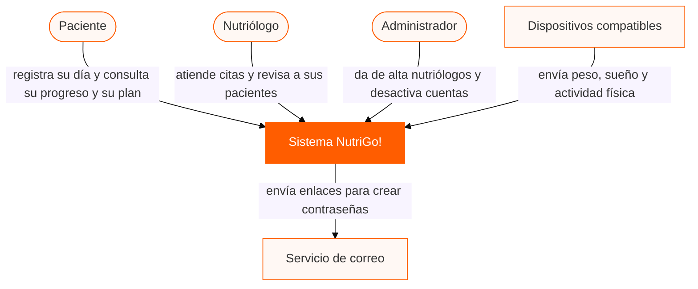
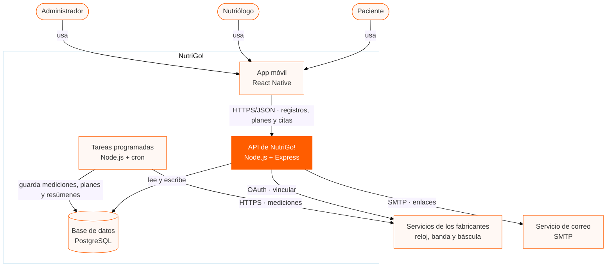
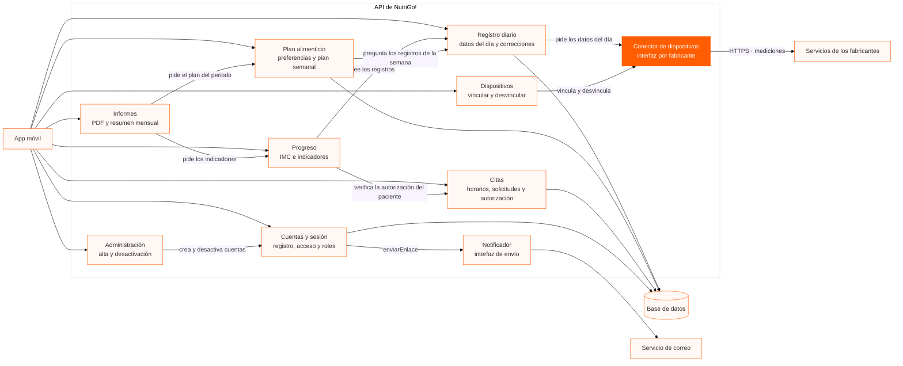
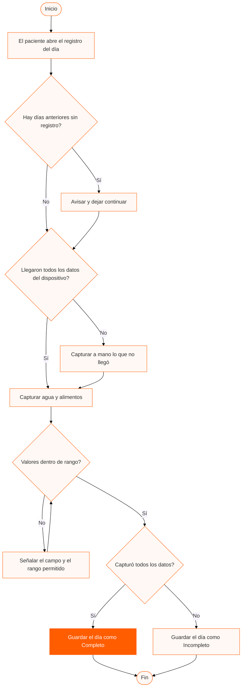
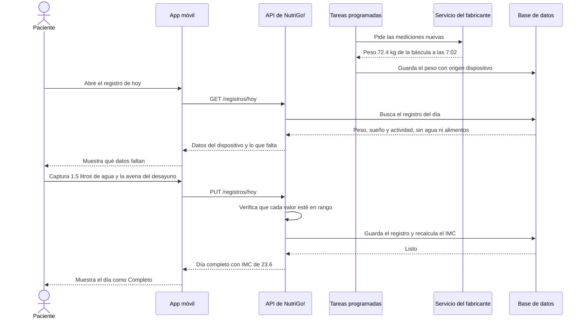
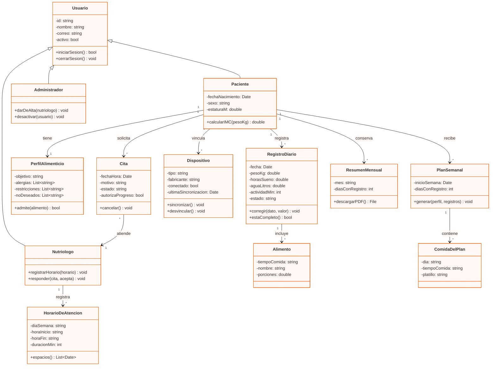
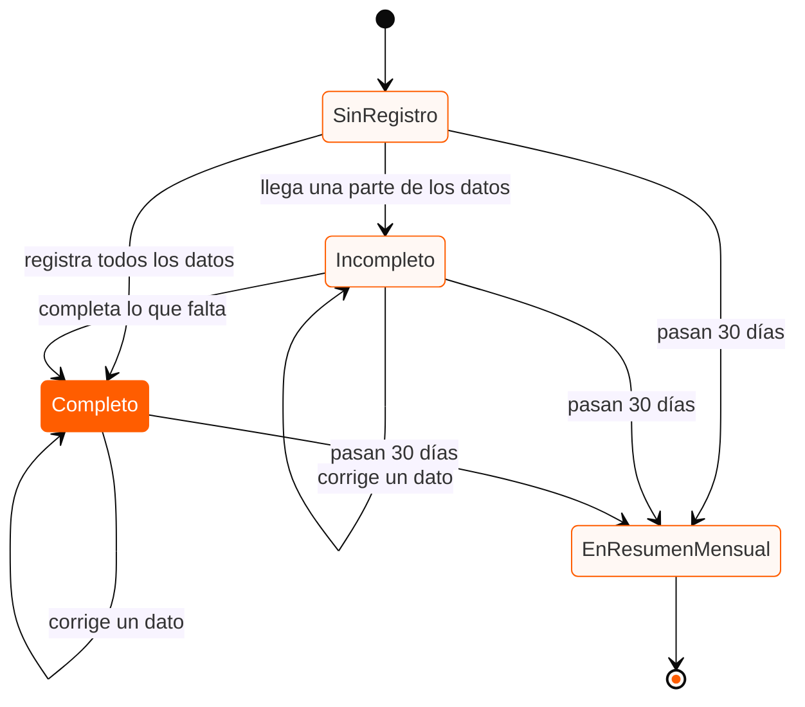
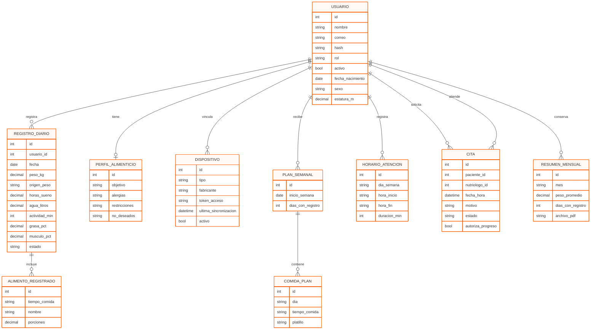

# Diagramas de arquitectura · NutriGo!

| Campo | Valor |
|---|---|
| **Sistema** | NutriGo!  |
| **Autor** | Diego Valdovinos Rodríguez |
| **Versión** | 1.0 |
| **Fecha** | 28/10/2026 |
| **Fuentes** | `docs/vision-del-producto.md`, `docs/especificacion-requisitos.md` |

Los diagramas van como texto de Mermaid, igual que el código: se comparan entre versiones y se revisan en el mismo diff. Para verlos, pega cada bloque en [mermaid.live](https://mermaid.live).

| # | Diagrama | Tipo |
|---|---|---|
| 1 | [Contexto (C4, nivel 1)](#1--nivel-1--diagrama-de-contexto) | `flowchart` |
| 2 | [Contenedores (C4, nivel 2)](#2--nivel-2--diagrama-de-contenedores) | `flowchart` |
| 3 | [Componentes (C4, nivel 3)](#3--nivel-3--diagrama-de-componentes) | `flowchart` |
| 4 | [Registrar el seguimiento diario](#4--registrar-el-seguimiento-diario) | `flowchart` con decisiones |
| 5 | [Registro del día con datos del dispositivo](#5--registro-del-día-con-datos-del-dispositivo) | `sequenceDiagram` |
| 6 | [Modelo de dominio](#6--modelo-de-dominio) | `classDiagram` |
| 7 | [Ciclo de vida de un registro diario](#7--ciclo-de-vida-de-un-registro-diario) | `stateDiagram-v2` |
| 8 | [Modelo de datos](#8--modelo-de-datos) | `erDiagram` |

---

## 1 · Nivel 1 · Diagrama de contexto

El sistema completo visto desde afuera: quién lo usa y con quién habla. No aparece ninguna tecnología a propósito, porque es el diagrama que se le puede enseñar al paciente sin explicarle nada. Los tres usuarios son los de la visión del producto, y cada flecha dice lo que hace cada uno con el sistema. Los dispositivos quedan fuera de la frontera porque NutriGo! no los fabrica, solo recibe lo que miden. El servicio de correo también queda afuera: NutriGo! lo usa para enviar los enlaces de contraseña, pero no es parte del sistema.

---

## 2 · Nivel 2 · Diagrama de contenedores

Las piezas que se despliegan y se ejecutan por separado, con la tecnología de cada una. El subgraph dibuja la frontera del sistema. Los tres usuarios entran por la misma app móvil y la API decide qué puede hacer cada uno según su rol. Las tareas programadas son un proceso aparte porque hacen el trabajo que nadie pide en el momento: descargar las mediciones de los dispositivos, generar el plan de cada lunes y sustituir los registros de más de 30 días por el resumen mensual. La app nunca habla con los dispositivos: los datos llegan por el servicio de cada fabricante, así que el registro funciona aunque el paciente no tenga la báscula cerca.

---

## 3 · Nivel 3 · Diagrama de componentes

Lo que hay dentro de la API, que es donde vive la lógica del sistema. Hay dos cosas que el dibujo deja ver. Ningún componente le habla directo a un fabricante: todos pasan por el Conector de dispositivos, que es el único que conoce cómo responde cada servicio. Es el patrón Adapter, y es lo que permite agregar un fabricante nuevo sin tocar el registro diario. La otra es que el Plan alimenticio y los Informes le preguntan sus datos al Registro diario y al Progreso en lugar de leer sus tablas, así cada regla vive en un solo lugar.

---

## 4 · Registrar el seguimiento diario

El caso de uso de registrar el seguimiento diario (CU-07), que es donde el flujo se puede complicar. La caja naranja es el único camino que deja el día completo. Los dos supuestos que resultaron falsos en la entrevista están en el dibujo: los días anteriores sin registro solo generan un aviso y nunca detienen el flujo, y lo que no envía el dispositivo se captura a mano. Si el paciente no termina, el día se guarda como incompleto y lo que falta no se rellena con ningún valor.

---

## 5 · Registro del día con datos del dispositivo

El flujo principal del producto en el tiempo, cruzando los contenedores. Las flechas sólidas son llamadas y las punteadas son respuestas. Lo importante es que el peso ya está guardado antes de que el paciente abra la app: las tareas programadas lo descargaron del servicio del fabricante en la mañana. Por eso el paciente solo captura lo que ningún dispositivo mide, que fue justo lo que pidió en la entrevista. La API revisa los rangos aunque el dato venga de la báscula, porque un dispositivo también puede enviar un valor equivocado.

---

## 6 · Modelo de dominio

Clases, atributos, métodos, visibilidad y multiplicidad: el signo menos es privado y el más es público. Paciente, Nutriólogo y Administrador heredan de Usuario porque comparten el inicio y el cierre de sesión, pero cada uno tiene funciones propias de su rol. Hay dos requisitos que se volvieron métodos: admite(alimento) en el perfil alimenticio es la regla de no incluir alergias, restricciones ni alimentos que no le gustan al paciente, y calcularIMC(pesoKg) vive en Paciente porque es quien tiene la estatura. La autorización para que el nutriólogo vea el progreso es un atributo de la cita, porque el paciente la da al solicitarla.

---

## 7 · Ciclo de vida de un registro diario

Por qué estados pasa el registro de un día y qué evento lo mueve; los corchetes [*] marcan el inicio y el fin. SinRegistro es un estado válido y puede quedarse así para siempre: el sistema no lo rellena con ningún valor, que es la regla que salió de la entrevista. La corrección de un dato no cambia el estado del día, por eso es una flecha que regresa al mismo estado. Y sin importar cómo haya quedado el día, a los 30 días todos terminan en el resumen mensual.

---

## 8 · Modelo de datos

Las tablas de la base de datos y cómo se relacionan, con la cardinalidad en los extremos de cada línea: || es uno y exactamente uno, o{ es cero o muchos, o| es cero o uno. Pacientes, nutriólogos y administradores están en la misma tabla USUARIO y se distinguen por el rol. CITA tiene dos relaciones con USUARIO porque guarda quién la solicita y quién la atiende. En REGISTRO_DIARIO la pareja usuario y fecha lleva restricción UNIQUE, para que exista un solo registro por día, y los datos que faltan se guardan como vacíos y no como cero: así la base de datos misma impide inventar un progreso que no ocurrió.

---
## Notas de entrega

- Los ocho bloques usan la sintaxis estándar de Mermaid; el tema del curso va en la línea `%%{init: ...}%%` de cada bloque y no se evalúa.
- El nivel 1 no menciona tecnología a propósito: es el diagrama que se le enseña al paciente, no al programador.
- Los niveles 2 y 3 son C4; los diagramas 4 a 8 corresponden al diseño de la Unidad 3 y son un adelanto de UML de la Unidad 4.
