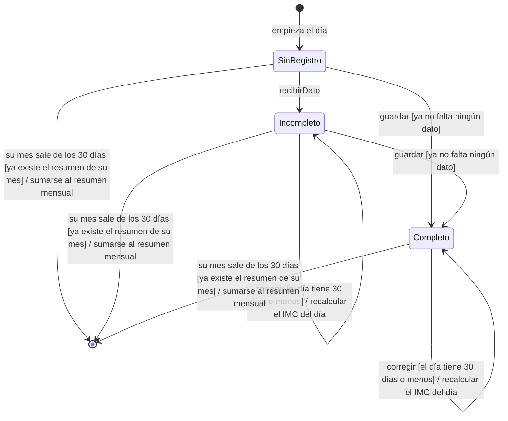
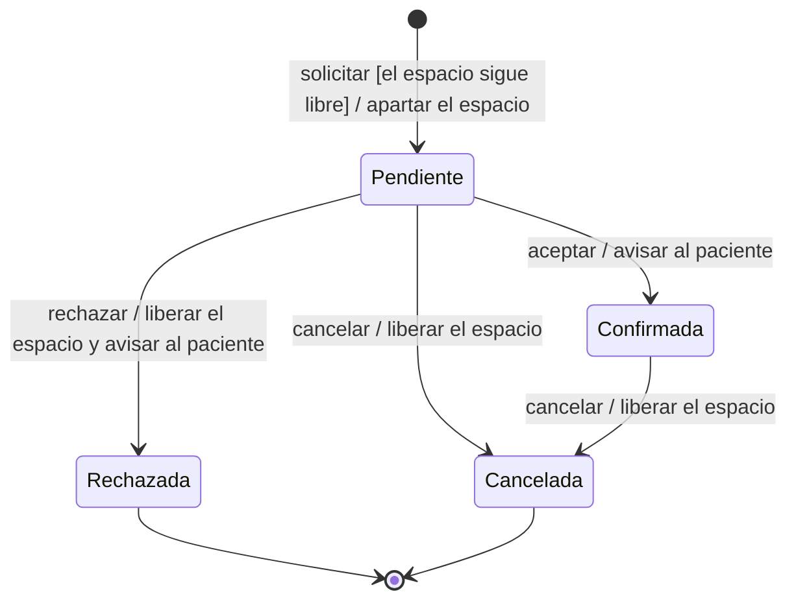
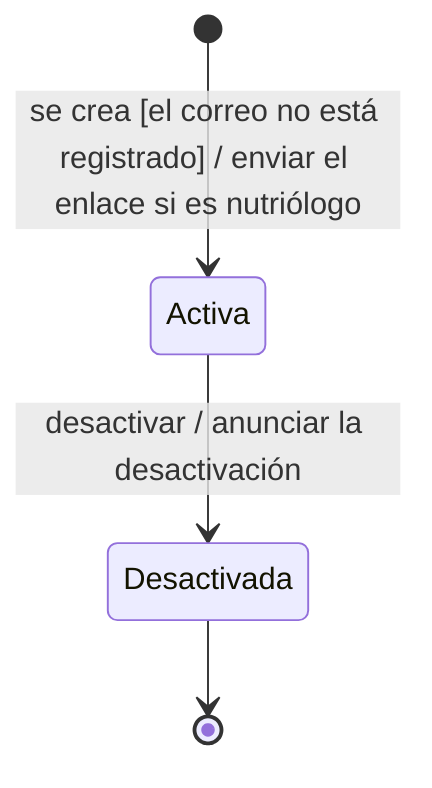

# Diagramas de estados y de actividad · NutriGo!

| Campo | Valor |
|---|---|
| **Sistema** | NutriGo! |
| **Autor** | Diego Valdovinos Rodríguez |
| **Versión** | 1.0 |
| **Fecha** | 17/11/2026 |
| **Fuentes** | `docs/especificacion-requisitos.md`, `docs/casos de uso/cu-07.md`, `docs/arch/diagrama-de-clases.md` |

## Qué clases necesitan máquina de estados

La prueba es buscar en el diagrama de clases un atributo que guarde un estado. En NutriGo! hay tres, y cada uno tiene su máquina:

| Clase | Atributo | Estados | Requisitos |
|---|---|---|---|
| RegistroDiario | `estado: EstadoRegistro` | SinRegistro, Incompleto, Completo | RF-007, RF-009, RF-010, RF-027, RF-031, RNF-CON-001 |
| Cita | `estado: EstadoCita` | Pendiente, Confirmada, Rechazada, Cancelada | RF-020, RF-021, RF-022, RF-029, RF-033 |
| Cuenta | `estado: EstadoCuenta` | Activa, Desactivada | RF-001, RF-003, RF-028, RF-029 |

Los estados de cada máquina son exactamente los valores de su enumeración en el diagrama de clases, ni uno más ni uno menos. Cada etiqueta sigue la forma `evento [guarda] / acción`, y los eventos son operaciones que la clase ya tiene.

---

## 1 · Ciclo de vida de un registro diario

**Cómo se lee.**
- **Empieza en SinRegistro, y ahí se puede quedar para siempre.** El sistema nunca lo rellena con un valor estimado, que es la regla que salió de la entrevista (RNF-CON-001). Que el día anterior siga sin registro tampoco impide registrar hoy (RF-009).
- **Basta un dato para pasar a Incompleto,** venga del dispositivo o de la captura a mano. Solo `guardar` con todos los datos lo deja Completo.
- **Corregir no cambia el estado, por eso la flecha regresa al mismo.** Tiene dos reglas del RF-010 en una línea: la guarda de los 30 días y la acción de recalcular el IMC si el dato corregido es el peso.
- **Todos terminan igual.** Cuando su mes sale de los últimos 30 días, el registro se suma al resumen mensual y deja de existir como registro (RF-027). La guarda es la regla de que ningún registro se elimina antes de que exista el resumen de su mes.

---

## 2 · Ciclo de vida de una cita

**Cómo se lee.**
- **La guarda de la entrada es la regla del RF-020.** Si otro paciente tomó el espacio antes, la solicitud no se registra y la cita ni siquiera nace. Si sí nace, el espacio se aparta para que nadie más lo pida.
- **A Cancelada se llega desde dos estados.** `cancelar` llega cuando el paciente confirma la cancelación (RF-021) o cuando el administrador desactiva al nutriólogo (RF-029). En los dos casos el espacio se libera.
- **Rechazar también libera el espacio, aceptar no.** Esa asimetría es la regla del RF-022 dibujada.
- **"Avisar al paciente" es el RF-033.** La cita anuncia su cambio con `anunciarCambio()` y el Notificador lo envía; la cita no sabe cómo (Observer).
- **Las operaciones ya existían.** `solicitar()`, `aceptar()`, `rechazar()` y `cancelar()` son de Cita, y `estaLibre()`, `apartar()` y `liberar()` son de HorarioDeAtencion.

**Lo que encontró.** Confirmada no tiene más salida que Cancelada. Después de que la consulta ocurre, nada mueve a la cita, así que una cita de hace tres meses sigue Confirmada y se podría cancelar. No es un error de dibujo: a la especificación le falta un requisito que diga qué pasa después de la consulta, por ejemplo un estado Atendida. No lo agregué al diagrama porque ningún requisito lo pide (regla 3 de consistencia). Queda anotado en [consistencia.md](consistencia.md) como candidato a una solicitud de cambio.

---

## 3 · Ciclo de vida de una cuenta

**Cómo se lee.**
- **La guarda de la entrada es la regla del correo único** del RF-001 y el RF-028. La acción solo aplica al nutriólogo, porque el administrador lo da de alta y el sistema le envía un enlace para crear su contraseña. El paciente escribe la suya al crear la cuenta.
- **Desactivar es el RF-029.** Al anunciar la desactivación, Consultas cancela las citas del nutriólogo y deja de mostrar sus horarios, sin que Cuentas tenga que conocer a Consultas.
- **Es la máquina más sencilla de las tres**, pero la cuenta tiene un atributo de estado, y por la regla 2 tiene que tener la suya.

**Lo que encontró.** Desactivada es el final: ningún requisito permite reactivar una cuenta. Si el administrador desactiva una por error, sus datos se conservan pero la persona no vuelve a entrar. Igual que con la cita, es un requisito que falta y no un error del diagrama.

---

## 4 · Diagrama de actividad · Registrar el seguimiento diario

El mismo CU-07 del diagrama de secuencia, ahora como proceso: qué pasa, en qué orden y quién lo hace. Las calles separan lo que hace el paciente de lo que hace el sistema.

```mermaid
flowchart TD
    subgraph pac[Paciente]
        p1("Elegir 'Registrar ahora'")
        p2("Revisar los datos de sus dispositivos")
        p3("Capturar los datos que faltan")
        p4{"¿Capturó todos los datos?"}
        p5("Elegir 'Guardar registro'")
        p6("Elegir 'Guardar lo que llevo'")
    end
    subgraph sis[Sistema]
        ini((" "))
        s0{"¿Hay días anteriores sin registro?"}
        s1("Avisar cuántos días faltan, sin detener al paciente")
        s2("Mostrar el registro del día")
        s3{"¿Llegaron todos los datos de los dispositivos?"}
        s4("Pasar a 'Por registrar' lo que no llegó")
        s5("Verificar que cada valor esté en rango")
        s6{"¿Todos los valores están en rango?"}
        s7("Señalar el campo y el rango permitido")
        s8("Guardar el día como Completo")
        s9("Guardar el día como Incompleto")
        s10("Mostrar el día con su estado y su IMC")
        fin(((" ")))
    end

    ini --> s0
    s0 -->|"[sí]"| s1
    s0 -->|"[no]"| p1
    s1 --> p1
    p1 --> s2
    s2 --> s3
    s3 -->|"[no]"| s4
    s3 -->|"[sí]"| p2
    s4 --> p2
    p2 --> p3
    p3 --> s5
    s5 --> s6
    s6 -->|"[no]"| s7
    s7 --> p3
    s6 -->|"[sí]"| p4
    p4 -->|"[sí]"| p5
    p4 -->|"[no]"| p6
    p5 --> s8
    p6 --> s9
    s8 --> s10
    s9 --> s10
    s10 --> fin

    style ini fill:#000,stroke:#000
    style fin fill:#000,stroke:#000
```

**Cómo se lee.**
- **El punto negro es el inicio y la diana es el final.** Cada acción va con verbo en infinitivo.
- **De cada rombo salen todos los caminos posibles, con su condición entre corchetes.**
- **El camino normal cruza de calle seis veces.** Es lo que este diagrama deja ver y la secuencia no: cada cruce es un momento en que el paciente espera al sistema o el sistema espera al paciente. Para cumplir el RNF-USA-001, de menos de 2 minutos, lo que se puede recortar son esos cruces, y por eso los datos de los dispositivos llegan antes de que el paciente abra la app.
- **Los dos supuestos que resultaron falsos en la entrevista están dibujados.** Los días sin registro solo generan un aviso y nunca detienen el flujo (RF-009), y lo que no envía el dispositivo se captura a mano (RF-008).

**Por qué solo uno.** Es el diagrama de comportamiento que menos se usa, y no hace falta dibujar todos los procesos. Elegí el del CU-07 porque es el caso de uso más importante y porque cruza muchas veces entre el paciente y el sistema, que es justo lo que este diagrama sirve para ver.

---

## Cuál de los tres usar

| Pregunta sobre NutriGo! | Diagrama | Dónde |
|---|---|---|
| ¿Qué objeto le pide qué cosa a cuál cuando Ana registra su día? | Secuencia | [diagrama-de-secuencia.md](diagrama-de-secuencia.md) |
| ¿Por qué situaciones pasa una cita desde que se pide hasta que termina? | Estados | Sección 2 de este archivo |
| ¿Qué pasos sigue el registro del día, con sus decisiones y quién hace cada uno? | Actividad | Sección 4 de este archivo |
