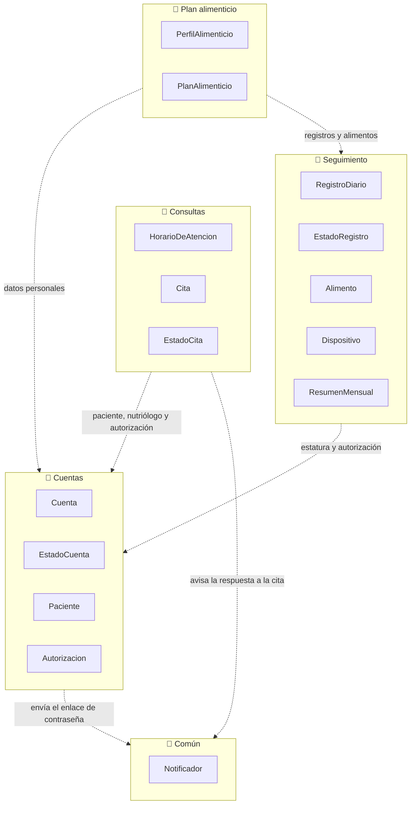
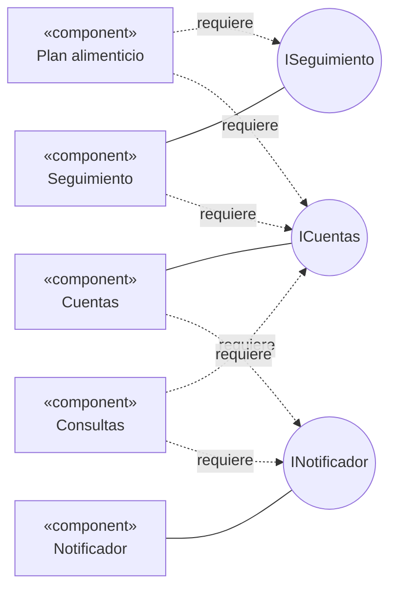

# Diagramas de paquetes y de componentes · NutriGo!

| Campo | Valor |
|---|---|
| **Sistema** | NutriGo! |
| **Autor** | Diego Valdovinos Rodríguez |
| **Versión** | 1.0 |
| **Fecha** | 17/11/2026 |
| **Fuentes** | Actividad 2 (módulos del sistema), `docs/arch/diagrama-de-clases.md`, `docs/arch/diagramas.md` (C4, nivel 3) |

Son los dos diagramas estructurales que faltaban. Con ellos quedan los cuatro del curso: clases y objetos en [diagrama-de-clases.md](diagrama-de-clases.md), paquetes y componentes aquí. Mermaid no tiene tipo propio para ninguno de los dos, así que los dos se dibujan con `flowchart`.

Los paquetes son los cuatro módulos de la Actividad 2, los mismos que ahora tiene el nivel 3 de C4:

| Módulo | Clases | Requisitos |
|---|---|---|
| **Cuentas** | Cuenta, EstadoCuenta, Paciente, Autorizacion | RF-001 a RF-006, RF-023, RF-024, RF-028, RF-029 |
| **Seguimiento** | RegistroDiario, EstadoRegistro, Alimento, Dispositivo, ResumenMensual | RF-007 a RF-014, RF-025 a RF-027, RF-031, RF-032 |
| **Plan alimenticio** | PerfilAlimenticio, PlanAlimenticio | RF-015 a RF-017, RF-030 |
| **Consultas** | HorarioDeAtencion, Cita, EstadoCita | RF-018 a RF-022, RF-033 |
| **Común** | Notificador | RF-004, RF-028, RF-033 |

Común no es un módulo de negocio: no tiene reglas ni clases del dominio, por eso el Notificador no aparece en el diagrama de clases. Solo sabe enviar un correo o un aviso al teléfono, y lo usan dos módulos. Es el mismo papel que tiene el paquete `comun` en el ejemplo de la guía.

---

## 1 · Diagrama de paquetes

Cada carpeta es un paquete con sus clases adentro. La flecha punteada significa "depende de" y apunta hacia lo que se usa.

### Cómo se lee

Las dependencias bajan y no regresan: Plan alimenticio y Consultas arriba, Seguimiento en medio, Cuentas abajo y Común al fondo. **No hay ningún ciclo**, y cada flecha sale de una relación del diagrama de clases:

| Dependencia | Sale de |
|---|---|
| Plan alimenticio → Cuentas | PerfilAlimenticio → Paciente y PlanAlimenticio → Paciente |
| Plan alimenticio → Seguimiento | PlanAlimenticio ◆ Alimento, `PlanAlimenticio ..> RegistroDiario` y `PerfilAlimenticio ..> Alimento` |
| Seguimiento → Cuentas | RegistroDiario, Dispositivo y ResumenMensual → Paciente; RegistroDiario le pide a Paciente el `calcularIMC()` |
| Consultas → Cuentas | Cita → Paciente, Cita → Cuenta y HorarioDeAtencion → Cuenta |
| Consultas → Común | La cita avisa al paciente cuando el nutriólogo responde (RF-033) |
| Cuentas → Común | La cuenta envía el enlace para crear o recuperar la contraseña (RF-004, RF-028) |

Es lo mismo que se escribió en la Actividad 2: Seguimiento habla con Cuentas, Plan alimenticio habla con Seguimiento y con Cuentas, Consultas habla con Cuentas, y Cuentas no le habla a ningún otro módulo. Su única flecha va a Común, que no decide nada.

### Lo que encontró este diagrama

La primera versión tenía tres ciclos, y ninguno se notaba en el diagrama de clases:
- **Paciente apuntaba a todo.** Paciente → RegistroDiario, Paciente → Cita, Paciente ◆ PerfilAlimenticio… hacían que Cuentas dependiera de los otros tres módulos, y los tres ya dependían de Cuentas. Se volteó la flecha: ahora cada registro, cita, plan o perfil sabe de qué paciente es.
- **Horario y Cuenta se conocían en los dos sentidos.** Quedó solo HorarioDeAtencion → Cuenta.
- **El resumen mensual incluía los planes.** Seguimiento dependía de Plan alimenticio y Plan alimenticio de Seguimiento. El resumen se quedó con los indicadores del mes, y el PDF del RF-026, que junta indicadores y plan, lo arma la app pidiéndole cada parte a su módulo.

Hay un caso que parece un cuarto ciclo y no lo es. Al desactivar a un nutriólogo (RF-029), sus citas pendientes o confirmadas se cancelan. Si Cuentas llamara a Consultas para cancelarlas, habría ciclo. Por eso se usa el Observer de la Actividad 2: Cuentas solo anuncia "esta cuenta se desactivó", y Consultas, que está escuchando, cancela sus citas. La flecha sigue yendo de Consultas a Cuentas.

---

## 2 · Diagrama de componentes

Las mismas piezas, ahora como componentes que se podrían reemplazar enteros sin tocar a los demás. Lo que define a cada uno no es lo que tiene adentro sino sus interfaces:
- **La bolita** es la interfaz que el componente **ofrece**. Aquí es el círculo unido con línea sólida.
- **La media luna** es la interfaz que **necesita** que alguien le dé. Mermaid no la dibuja, así que se marca con la flecha punteada "requiere" que llega a la bolita de otro componente.

### Las interfaces

| Interfaz | La ofrece | La requieren | Qué contesta |
|---|---|---|---|
| **ICuentas** | Cuentas | Seguimiento, Plan alimenticio, Consultas | Los datos personales y la estatura del paciente, si un nutriólogo está autorizado a ver a un paciente (RNF-SEG-002) y qué nutriólogos están activos. También permite registrar la autorización al pedir una cita (RF-023). |
| **ISeguimiento** | Seguimiento | Plan alimenticio | Los registros de una semana, con cuántos días tienen registro (RF-017). |
| **INotificador** | Notificador | Cuentas, Consultas | `enviarEnlace(correo)` para la contraseña y `notificar(paciente, mensaje)` para el aviso al teléfono (RF-033). |

Consultas y Plan alimenticio no ofrecen ninguna interfaz a otro módulo: solo los usa la app.

### Por qué así

- **Nadie conoce al componente de al lado, solo su bolita.** Consultas no sabe si el Notificador manda el aviso por un servicio u otro; si mañana se cambia el servicio de notificaciones, Consultas no se toca. Es el Adapter de la Unidad 3 visto desde arriba.
- **Seguimiento también es un adaptador hacia afuera.** Adentro tiene el conector con el servicio de cada fabricante, y ningún otro componente habla con un fabricante. Por eso los demás no se enteran cuando se agrega un dispositivo nuevo, como el anillo inteligente de la Actividad 1.
- **Coincide con los paquetes.** Cada flecha "requiere" es una flecha "depende de" del diagrama de paquetes, con la misma dirección.
