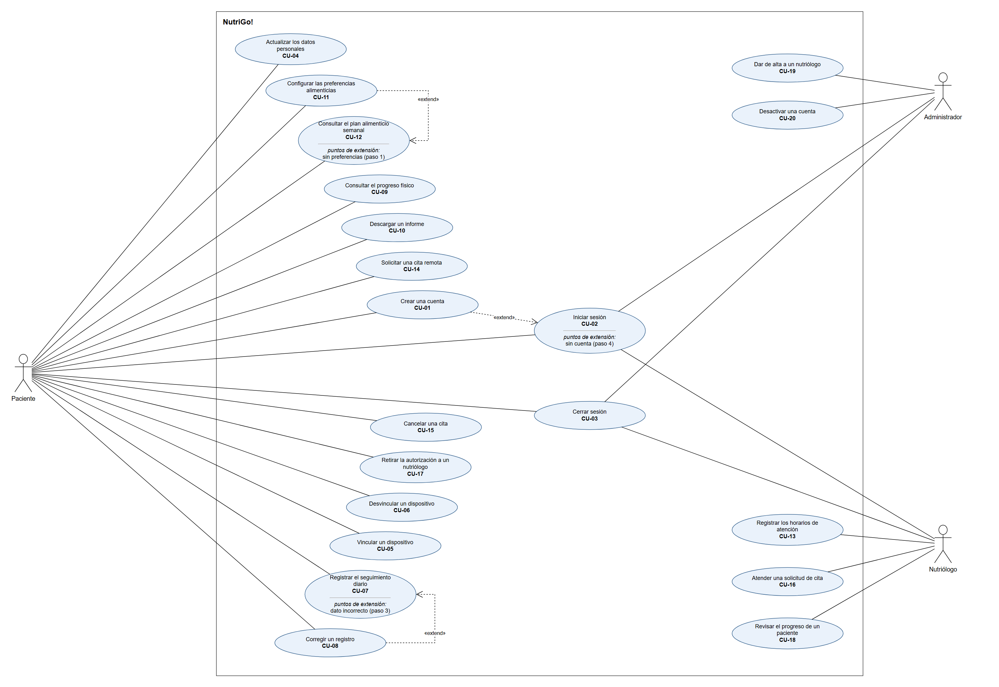
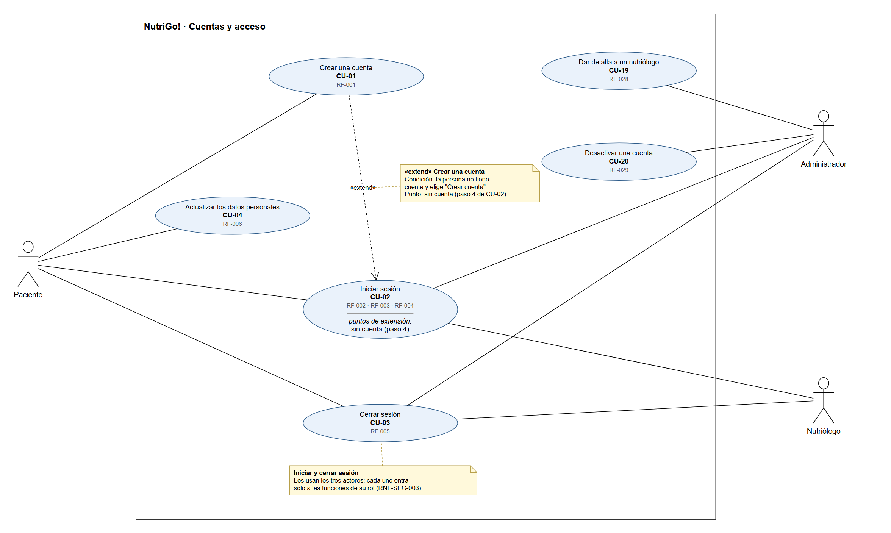
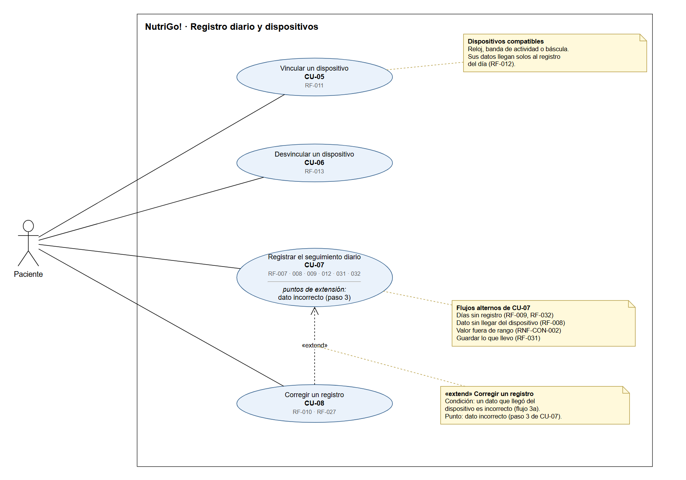
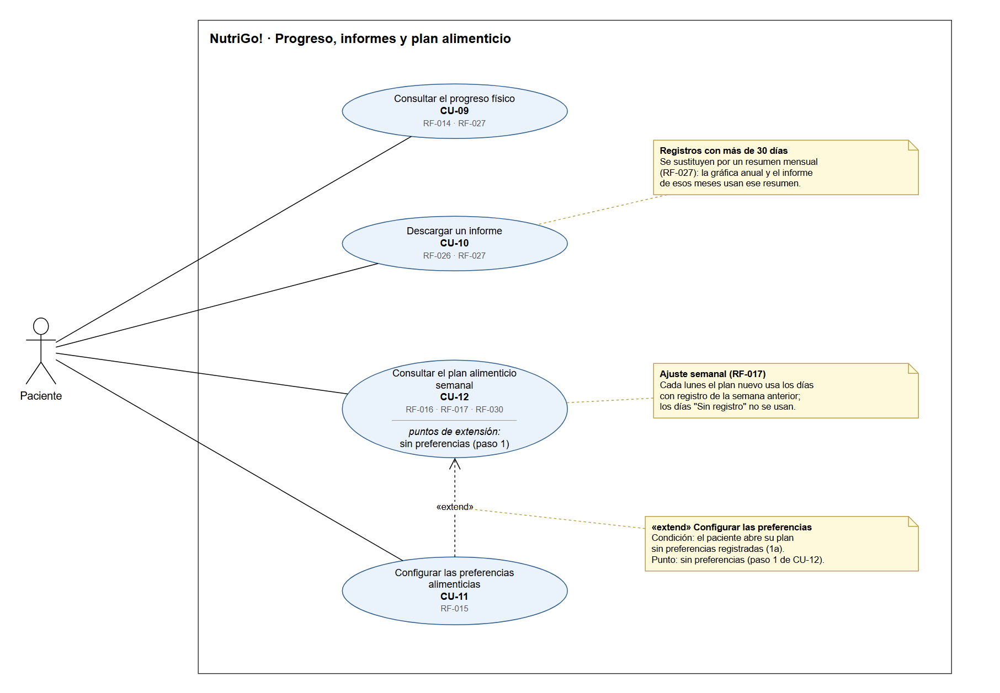
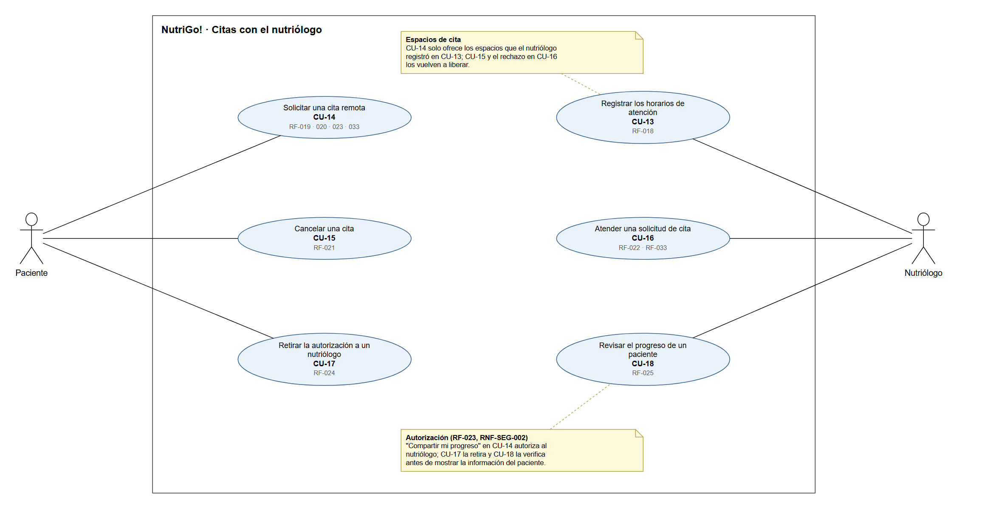

# Especificación de requisitos

**Plantilla del curso · Ingeniería de Software I · SIS3407**

| Campo | Valor |
|---|---|
| **Sistema** | NutriGo! |
| **Autor** | Diego Valdovinos Rodríguez |
| **Versión** | 1.1 |
| **Fecha de la última actualización** | 08/10/2026 |

## 1. Propósito y alcance

**Propósito del documento:**
Este documento especifica los requisitos funcionales y no funcionales de NutriGo!, los casos de uso que los realizan y la trazabilidad entre requisitos, casos de uso y prototipo. Es la base para diseñar y construir la aplicación, y va dirigido a quienes van a diseñar, desarrollar y validar el sistema.

**Alcance del sistema:**
NutriGo! es una aplicación móvil que permite a las personas llevar un seguimiento diario de su alimentación y de sus cambios físicos, consultar su progreso y recibir un plan alimenticio personalizado que se adapta a sus resultados. Registra el peso en ayunas, las horas de sueño, el agua consumida, la alimentación y la actividad física diariamente, ya sea de forma automática o manual, y muestra el progreso del usuario mediante su peso, IMC, porcentaje de grasa y porcentaje de músculo. Permite registrar preferencias, alergias y alimentos que no le gustan al usuario para generar un plan alimenticio personalizado según sus datos, objetivos, preferencias y restricciones, y ajusta ese plan cada semana según los resultados registrados. Se conecta con dispositivos existentes compatibles, como relojes inteligentes, bandas de actividad y básculas inteligentes, para recibir datos del usuario. Proporciona los horarios disponibles del nutriólogo para atender dudas o solicitar una cita remota, y permite al nutriólogo consultar el progreso de sus pacientes y atender sus solicitudes dentro de los horarios establecidos. También permite al usuario descargar en PDF sus avances y planes de alimentación de forma semanal o mensual.

**Fuera del alcance:**
- No realiza diagnósticos médicos.
- No procesa pagos ni cobros dentro de la aplicación durante el desarrollo del semestre.
- No diseña ni fabrica dispositivos propios para medir los datos del usuario.

## 2. Usuarios y su contexto

| Usuario | Qué hace hoy sin el sistema | Qué espera del sistema |
|---|---|---|
| Paciente | Utiliza notas del teléfono, hojas de cálculo, aplicaciones diferentes o lleva sus registros de memoria. Cuando tiene muchas actividades se le olvida registrar sus datos y, al acumular registros sin completar, termina dejando el seguimiento. Acude con un nutriólogo cuando sus horarios se lo permiten. | Registrar sus datos, consultar su plan, revisar su progreso y comunicarse con un nutriólogo. Que sea rápido, sencillo y que sus datos sean confiables. Que la información se obtenga automáticamente de sus dispositivos y tener que registrar a mano solo lo que no se pueda obtener de ellos. |
| Nutriólogo | Da seguimiento a sus pacientes durante las consultas, pero el seguimiento entre una consulta y otra puede ser limitado. | Consultar el progreso de sus pacientes, revisar sus registros y atender solicitudes dentro de sus horarios establecidos. |
| Administrador | Este rol solo existe dentro del sistema. | Gestionar usuarios y mantener el funcionamiento del sistema. |

**Conflictos identificados entre usuarios:**
El paciente puede solicitar comunicarse con un nutriólogo en cualquier momento, pero este solo puede atenderlo durante sus horarios establecidos, lo que puede generar una espera para el paciente. Resolución adoptada: el paciente solo puede solicitar citas en los horarios que el nutriólogo registró, y su solicitud queda pendiente hasta que el nutriólogo la acepta o la rechaza.

## 3. Requisitos funcionales

### 3.1 Resumen

Cada requisito se nombra con la acción que realiza el sistema y el objeto sobre el que la realiza. La columna **Estado** indica si el requisito fue **confirmado** por el cliente en la entrevista del 22/09/2026 o si es un **supuesto** del equipo que el cliente no validó en la entrevista. Los requisitos que no se trataron en la entrevista se marcan como supuesto aunque vengan de la visión o del prototipo.

| ID | Nombre | Prioridad | Origen | Estado |
|---|---|---|---|---|
| RF-001 | Creación de la cuenta de un paciente | Imprescindible | Caso de uso CU-01 | Supuesto |
| RF-002 | Inicio de sesión | Imprescindible | Caso de uso CU-02 | Supuesto |
| RF-003 | Rechazo del acceso con datos incorrectos o cuenta desactivada | Imprescindible | Caso de uso CU-02 | Supuesto |
| RF-004 | Recuperación de la contraseña | Importante | Caso de uso CU-02 | Supuesto |
| RF-005 | Cierre de sesión | Imprescindible | Caso de uso CU-03 | Supuesto |
| RF-006 | Actualización de los datos personales | Importante | Caso de uso CU-04 | Supuesto |
| RF-007 | Registro de los datos del día | Imprescindible | Visión del producto | Confirmado |
| RF-008 | Captura manual de los datos que no llegan del dispositivo | Imprescindible | Entrevista (22/09/2026) | Confirmado |
| RF-009 | Registro del día actual sin completar días anteriores | Imprescindible | Entrevista (22/09/2026) | Confirmado |
| RF-010 | Corrección de un dato registrado | Importante | Caso de uso CU-08 | Confirmado |
| RF-011 | Vinculación de un dispositivo | Importante | Visión del producto | Confirmado |
| RF-012 | Obtención automática de los datos de los dispositivos vinculados | Importante | Visión del producto | Confirmado |
| RF-013 | Desvinculación de un dispositivo | Importante | Caso de uso CU-06 | Supuesto |
| RF-014 | Consulta del progreso físico | Imprescindible | Visión del producto | Confirmado |
| RF-015 | Registro de las preferencias alimenticias | Imprescindible | Visión del producto | Confirmado |
| RF-016 | Generación del plan alimenticio semanal | Imprescindible | Visión del producto | Confirmado |
| RF-017 | Ajuste del plan de la siguiente semana con los registros | Importante | Visión del producto | Confirmado |
| RF-018 | Registro de los horarios de atención del nutriólogo | Imprescindible | Caso de uso CU-13 | Supuesto |
| RF-019 | Consulta de los horarios disponibles de los nutriólogos | Imprescindible | Visión del producto | Confirmado |
| RF-020 | Solicitud de una cita remota | Imprescindible | Visión del producto | Confirmado |
| RF-021 | Cancelación de una cita | Importante | Caso de uso CU-15 | Supuesto |
| RF-022 | Respuesta a una solicitud de cita | Imprescindible | Visión del producto | Supuesto |
| RF-023 | Autorización de acceso a un nutriólogo | Imprescindible | Visión del producto | Confirmado |
| RF-024 | Retiro de la autorización a un nutriólogo | Importante | Caso de uso CU-17 | Supuesto |
| RF-025 | Consulta del progreso de un paciente autorizado | Imprescindible | Visión del producto | Supuesto |
| RF-026 | Descarga del informe de avances en PDF | Importante | Visión del producto | Supuesto |
| RF-027 | Sustitución de los registros antiguos por un resumen mensual | Importante | Visión del producto | Supuesto |
| RF-028 | Alta de un nutriólogo | Imprescindible | Caso de uso CU-19 | Supuesto |
| RF-029 | Desactivación de una cuenta | Importante | Caso de uso CU-20 | Supuesto |
| RF-030 | Consulta del plan alimenticio | Imprescindible | Visión del producto | Confirmado |
| RF-031 | Guardado de un registro del día incompleto | Imprescindible | Entrevista (22/09/2026) | Confirmado |
| RF-032 | Registro de un día anterior | Deseable | Prototipo (P02-E1) | Supuesto |
| RF-033 | Notificación de la respuesta a una solicitud de cita | Importante | Prototipo (P10-A, P10-B) | Supuesto |

### 3.2 Fichas

Los códigos entre paréntesis, como P01-E1, corresponden a las pantallas del prototipo en Figma.

**RF-001 · Creación de la cuenta de un paciente**

| Campo | Contenido |
|---|---|
| Descripción | El sistema crea la cuenta de un paciente con su nombre, correo electrónico, contraseña, fecha de nacimiento, sexo y estatura en centímetros. |
| Origen | Caso de uso CU-01. **Supuesto del equipo:** no se trató en la entrevista; el paciente necesita una cuenta antes de usar cualquier función de la aplicación. |
| Prioridad | Imprescindible |
| Criterio de aceptación | Cuando una persona llena nombre, correo, contraseña, fecha de nacimiento, sexo y estatura (por ejemplo, 175 cm) y elige "Crear cuenta", el sistema crea la cuenta y muestra el Panel principal con la sesión iniciada (P02). Si falta algún dato, no crea la cuenta y señala el campo vacío. Si el correo ya pertenece a una cuenta, no crea la cuenta, lo indica y ofrece "Inicia sesión". Si la estatura está fuera de 50 a 250 cm, no crea la cuenta y muestra el rango permitido. |
| Relacionado con | RF-002, RF-006, RF-014, RF-016, RNF-CON-002 |

**RF-002 · Inicio de sesión**

| Campo | Contenido |
|---|---|
| Descripción | El sistema da acceso a la aplicación a un usuario registrado que ingresa su correo electrónico y su contraseña. |
| Origen | Caso de uso CU-02. **Supuesto del equipo:** no se trató en la entrevista; el inicio de sesión es previo a todo uso de la cuenta. |
| Prioridad | Imprescindible |
| Criterio de aceptación | Con un correo registrado de una cuenta activa y su contraseña correcta, el usuario entra a la pantalla de inicio de su rol: el paciente al Panel principal (P02), el nutriólogo al Panel del nutriólogo (P11) y el administrador a Usuarios (P15). |
| Relacionado con | RF-001, RF-003, RF-005, RNF-SEG-001, RNF-SEG-003 |

**RF-003 · Rechazo del acceso con datos incorrectos o cuenta desactivada**

| Campo | Contenido |
|---|---|
| Descripción | El sistema impide el acceso a la aplicación cuando el correo no pertenece a una cuenta registrada, cuando la contraseña no corresponde o cuando la cuenta está desactivada. |
| Origen | Caso de uso CU-02, flujos alternos. **Supuesto del equipo:** no se trató en la entrevista; nadie debe entrar a la aplicación sin una cuenta o con datos incorrectos. |
| Prioridad | Imprescindible |
| Criterio de aceptación | Si una persona intenta entrar con un correo que no está registrado o con una contraseña incorrecta, el sistema no le da acceso y en ambos casos muestra el mismo mensaje, "El correo o la contraseña no son correctos", sin indicar cuál de los dos datos falló (P01-E1). En esa pantalla ofrece las opciones "Intentar de nuevo", "¿Olvidaste tu contraseña?" y "Crear cuenta". Si la cuenta está desactivada, no le da acceso y le indica que su cuenta está desactivada. |
| Relacionado con | RF-001, RF-002, RF-004, RF-029, RNF-SEG-001 |

**RF-004 · Recuperación de la contraseña**

| Campo | Contenido |
|---|---|
| Descripción | El sistema envía al correo registrado del usuario un enlace para crear una nueva contraseña. |
| Origen | Caso de uso CU-02, flujo alterno. **Supuesto del equipo:** no se trató en la entrevista; el usuario que olvida su contraseña necesita una forma de volver a entrar. |
| Prioridad | Importante |
| Criterio de aceptación | Al escribir un correo registrado y elegir "Enviar enlace" (P01-B), el sistema muestra "Revisa tu correo" con el correo al que envió el enlace (P01-C) y el enlace llega a ese correo. Después de crear la nueva contraseña, el usuario entra con ella y la contraseña anterior ya no funciona. Si el correo no está registrado, el sistema muestra la misma pantalla "Revisa tu correo", pero no envía ningún enlace, para no revelar qué correos tienen cuenta. |
| Relacionado con | RF-002, RF-003 |

**RF-005 · Cierre de sesión**

| Campo | Contenido |
|---|---|
| Descripción | El sistema cierra la sesión del usuario cuando este lo solicita. |
| Origen | Caso de uso CU-03. **Supuesto del equipo:** no se trató en la entrevista; el usuario necesita salir de su cuenta para que nadie más vea su información desde su teléfono. |
| Prioridad | Imprescindible |
| Criterio de aceptación | Después de elegir "Cerrar sesión" (en Perfil P07, en el Panel del nutriólogo P11 o en Usuarios P15) y confirmar, la aplicación muestra la pantalla de inicio de sesión. Si el usuario presiona "atrás" en su teléfono, la aplicación sigue en el inicio de sesión y no muestra ninguna información hasta que vuelve a entrar. |
| Relacionado con | RF-002, RNF-SEG-001 |

**RF-006 · Actualización de los datos personales**

| Campo | Contenido |
|---|---|
| Descripción | El sistema guarda los cambios que el paciente hace a su nombre, fecha de nacimiento, sexo y estatura. |
| Origen | Caso de uso CU-04. **Supuesto del equipo:** no se trató en la entrevista; los datos personales, como la estatura, se usan para calcular el IMC y generar el plan. |
| Prioridad | Importante |
| Criterio de aceptación | Si un paciente que pesa 72.4 kg cambia su estatura de 174 cm a 175 cm y elige "Guardar cambios" (P07-A), sus datos personales muestran 175 cm y su IMC pasa de 23.9 a 23.6. Si sale sin guardar, sus datos siguen mostrando 174 cm. Si escribe una estatura fuera de 50 a 250 cm, el sistema no guarda el cambio y muestra el rango permitido. |
| Relacionado con | RF-001, RF-014, RNF-CON-002 |

**RF-007 · Registro de los datos del día**

| Campo | Contenido |
|---|---|
| Descripción | El sistema registra para cada día el peso en ayunas, las horas de sueño, el consumo de agua, la alimentación y la actividad física del paciente. |
| Origen | Visión del producto (20/08/2026). **Confirmado** en la entrevista (22/09/2026): estos son los datos que la persona necesita registrar para llevar su seguimiento. |
| Prioridad | Imprescindible |
| Criterio de aceptación | Si el paciente tiene 72.4 kg, 7 h 10 min de sueño, 1.5 litros de agua, avena en el desayuno y 35 minutos de caminata, y elige "Guardar registro", los cinco datos aparecen en el registro de ese día con la fecha correcta (P03). El sistema muestra "Tu día quedó registrado" con el estado "Completo" y el IMC del día calculado con ese peso (P04). Cada alimento se registra indicando si fue parte del desayuno, la comida, la cena o una colación. |
| Relacionado con | RF-008, RF-009, RF-012, RF-031, RNF-USA-001, RNF-CON-002 |

**RF-008 · Captura manual de los datos que no llegan del dispositivo**

| Campo | Contenido |
|---|---|
| Descripción | El sistema habilita la captura manual de cualquier dato del registro diario que no se haya obtenido de un dispositivo. |
| Origen | Entrevista (22/09/2026). **Confirmado:** se suponía que el registro sería automático, pero en la entrevista se descubrió que no todos los datos pueden obtenerse de un dispositivo y que a veces el dispositivo no registra bien la información. |
| Prioridad | Imprescindible |
| Criterio de aceptación | Si la báscula no envió el peso del día, el peso aparece como "Sin dato de la báscula" y se habilita el campo "Peso en ayunas en kg" en la sección "Por registrar" (P03-E1). Si el paciente escribe 724, el sistema no lo acepta, muestra "Debe estar entre 20 y 300 kg" y sugiere 72.4, que es el valor capturado dividido entre 10 (P03-E2). Los alimentos siempre se capturan a mano porque ningún dispositivo los registra. |
| Relacionado con | RF-007, RF-012, RNF-CON-002 |

**RF-009 · Registro del día actual sin completar días anteriores**

| Campo | Contenido |
|---|---|
| Descripción | El sistema registra la información del día actual aunque existan días anteriores sin registro. |
| Origen | Entrevista (22/09/2026). **Confirmado:** se suponía que el paciente completaría los días que olvidó, pero en la entrevista se descubrió que muchas veces no recuerda qué comió ni las cantidades, y que acumular registros sin completar hace que deje el seguimiento. |
| Prioridad | Imprescindible |
| Criterio de aceptación | Con tres días anteriores vacíos, el Panel principal muestra "Tienes 3 días sin registro" y "Registrar ahora" abre el registro de hoy (P02-E1). El paciente guarda el registro de hoy sin que el sistema le pida completar esos días, y los tres días aparecen en el historial como "Sin registro". |
| Relacionado con | RF-007, RF-032, RNF-CON-001 |

**RF-010 · Corrección de un dato registrado**

| Campo | Contenido |
|---|---|
| Descripción | El sistema reemplaza un dato registrado por el valor que el paciente capture como corrección. |
| Origen | Caso de uso CU-08. **Confirmado** en la entrevista (22/09/2026): a veces el dispositivo no registra bien la información y la persona necesita corregirla para que su progreso no muestre datos equivocados. |
| Prioridad | Importante |
| Criterio de aceptación | Si el reloj registró 7 h 10 min de sueño y el paciente lo corrige a 7 h 40 min con "Guardar corrección" (P03-A), el registro de ese día muestra 7 h 40 min en lugar del valor que envió el reloj, y una sincronización posterior del reloj no vuelve a cambiarlo. Si el dato corregido es el peso, el IMC de ese día se recalcula con el nuevo peso. Los días con más de 30 días de antigüedad no muestran la opción de corregir. |
| Relacionado con | RF-007, RF-014, RF-027, RNF-CON-002 |

**RF-011 · Vinculación de un dispositivo**

| Campo | Contenido |
|---|---|
| Descripción | El sistema vincula la cuenta del paciente con un reloj inteligente, una banda de actividad, una báscula inteligente u otro dispositivo compatible. |
| Origen | Visión del producto (20/08/2026). **Confirmado** en la entrevista (22/09/2026): el cliente prefiere que los datos disponibles se obtengan automáticamente de sus dispositivos. |
| Prioridad | Importante |
| Criterio de aceptación | La pantalla "Vincular un dispositivo" muestra reloj inteligente, banda de actividad, báscula inteligente y otro dispositivo, cada uno con los datos que mide (P08-A). Después de elegir la banda de actividad y "Autorizar y vincular", la banda aparece en Mis dispositivos como "Conectada" con su última sincronización (P08-B). Si el paciente no autoriza el acceso o el dispositivo no es compatible, el sistema no lo vincula, lo indica y el paciente sigue registrando a mano. |
| Relacionado con | RF-008, RF-012, RF-013 |

**RF-012 · Obtención automática de los datos de los dispositivos vinculados**

| Campo | Contenido |
|---|---|
| Descripción | El sistema obtiene de los dispositivos vinculados el peso, el porcentaje de grasa, el porcentaje de músculo, las horas de sueño y la actividad física que cada dispositivo mida. |
| Origen | Visión del producto (20/08/2026). **Confirmado** en la entrevista (22/09/2026): el cliente quiere registrar a mano solo lo que no se pueda obtener de sus dispositivos. |
| Prioridad | Importante |
| Criterio de aceptación | Después de que la báscula vinculada se sincroniza, el peso del día aparece en la sección "De tus dispositivos" del registro de hoy con la etiqueta "Báscula", sin que el paciente lo capture, y Mis dispositivos actualiza la hora de "Última sincronización" (P03, P08). La báscula aporta peso, grasa y músculo; el reloj y la banda aportan sueño y actividad física. Los datos que ningún dispositivo vinculado mide aparecen en "Por registrar". |
| Relacionado con | RF-007, RF-008, RF-011, RF-014, RNF-CON-002 |

**RF-013 · Desvinculación de un dispositivo**

| Campo | Contenido |
|---|---|
| Descripción | El sistema desvincula un dispositivo de la cuenta del paciente cuando este lo solicita. |
| Origen | Caso de uso CU-06. **Supuesto del equipo:** no se trató en la entrevista; el paciente necesita dejar de recibir datos de un dispositivo que ya no usa. |
| Prioridad | Importante |
| Criterio de aceptación | Antes de desvincular, el sistema pide confirmar y aclara que los datos ya obtenidos se conservan (P08-C). Después de confirmar, la báscula desaparece de Mis dispositivos y se muestra "Desvinculaste tu báscula. Tu historial se conserva." (P08-D). Las nuevas mediciones de esa báscula ya no aparecen en NutriGo! y los datos que ya se habían obtenido siguen en el historial. Si el paciente elige "Cancelar", la báscula sigue vinculada. |
| Relacionado con | RF-008, RF-011, RF-012 |

**RF-014 · Consulta del progreso físico**

| Campo | Contenido |
|---|---|
| Descripción | El sistema muestra el peso, el IMC, el porcentaje de grasa corporal y el porcentaje de músculo del paciente, junto con su evolución durante la última semana, el último mes o el último año. |
| Origen | Visión del producto (20/08/2026). **Confirmado** en la entrevista (22/09/2026): revisar solo el peso no es suficiente; también se necesitan el IMC, la grasa y el músculo. |
| Prioridad | Imprescindible |
| Criterio de aceptación | Con una estatura de 175 cm y un peso de 72.4 kg, el sistema muestra un IMC de 23.6 (P05). Al elegir "Mes", la gráfica muestra un punto por cada día que tiene ese indicador registrado y la diferencia entre el primer y el último valor del periodo, por ejemplo "−1.6 kg en el último mes". Al elegir "Año", muestra un punto por mes tomado del resumen mensual. Los días sin dato aparecen como hueco marcado "Sin registro". Si no existe ninguna medición de grasa o de músculo, esos indicadores aparecen como "Sin medición". |
| Relacionado con | RF-006, RF-007, RF-012, RF-027, RNF-USA-002, RNF-CON-001 |

**RF-015 · Registro de las preferencias alimenticias**

| Campo | Contenido |
|---|---|
| Descripción | El sistema registra el objetivo del paciente, sus alergias, sus restricciones alimenticias y los alimentos que no le gustan. |
| Origen | Visión del producto (20/08/2026). **Confirmado** en la entrevista (22/09/2026): un plan debe considerar los objetivos, las preferencias, las alergias y las restricciones de la persona. |
| Prioridad | Imprescindible |
| Criterio de aceptación | El objetivo se elige entre "Bajar de peso", "Mantener mi peso" y "Ganar masa muscular" (P07-B). Cuando el paciente elige "Bajar de peso", agrega "Cacahuate" en alergias, "Sin lactosa" en restricciones y "Brócoli" en alimentos que no le gustan y elige "Guardar preferencias", los cuatro datos aparecen al volver a abrir la sección, y el sistema indica que los cambios se aplican en su siguiente plan. Si no elige un objetivo, el sistema no guarda y señala ese campo. |
| Relacionado con | RF-016, RF-017 |

**RF-016 · Generación del plan alimenticio semanal**

| Campo | Contenido |
|---|---|
| Descripción | El sistema genera un plan alimenticio semanal considerando los datos personales, el objetivo, las alergias, las restricciones y los alimentos que no le gustan al paciente. |
| Origen | Visión del producto (20/08/2026). **Confirmado** en la entrevista (22/09/2026): el plan debe tomar en cuenta los objetivos, las alergias y las restricciones de la persona. |
| Prioridad | Imprescindible |
| Criterio de aceptación | Para un paciente con alergia al cacahuate, restricción "Sin lactosa" y que no le gusta el brócoli, el plan contiene siete días, de lunes a domingo, cada uno con desayuno, colación, comida y cena, y ninguna comida incluye cacahuate, brócoli ni lácteos con lactosa. Si el paciente todavía no registra sus preferencias alimenticias, el sistema se las pide antes de generar su primer plan. |
| Relacionado con | RF-001, RF-015, RF-017, RF-030 |

**RF-017 · Ajuste del plan de la siguiente semana con los registros**

| Campo | Contenido |
|---|---|
| Descripción | El sistema genera el plan de la siguiente semana utilizando los registros y resultados de la semana anterior. |
| Origen | Visión del producto (20/08/2026). **Confirmado** en la entrevista (22/09/2026): sería útil ajustar el plan de la siguiente semana con los registros y resultados anteriores. |
| Prioridad | Importante |
| Criterio de aceptación | Cada lunes el paciente tiene un plan nuevo que reemplaza al de la semana anterior y muestra el aviso "Ajustamos tu plan con los N días que registraste la semana pasada", donde N coincide con los días de esa semana que tienen registro en el historial (P09). Los días marcados como "Sin registro" no se usan para el ajuste. Los cambios de preferencias guardados durante la semana se aplican en este plan nuevo. |
| Relacionado con | RF-007, RF-015, RF-016, RF-030, RNF-CON-001 |

**RF-018 · Registro de los horarios de atención del nutriólogo**

| Campo | Contenido |
|---|---|
| Descripción | El sistema registra los horarios de atención del nutriólogo por día de la semana y la duración de cada cita. |
| Origen | Caso de uso CU-13. **Supuesto del equipo:** la entrevista se hizo desde el punto de vista del paciente y no se verificó cómo organiza el nutriólogo sus horarios. |
| Prioridad | Imprescindible |
| Criterio de aceptación | Si el nutriólogo registra los martes de 16:00 a 18:00 con citas de 30 minutos, antes de guardar el sistema indica "Los pacientes verán 4 espacios cada martes" (P14) y, después de guardar, los pacientes ven los espacios de 16:00, 16:30, 17:00 y 17:30. Si la hora de fin es igual o anterior a la hora de inicio, el sistema no guarda el horario y señala el error. Si después modifica sus horarios, las citas pendientes y confirmadas se conservan. |
| Relacionado con | RF-019, RF-022, RNF-SEG-003 |

**RF-019 · Consulta de los horarios disponibles de los nutriólogos**

| Campo | Contenido |
|---|---|
| Descripción | El sistema muestra al paciente los horarios disponibles de los nutriólogos para las próximas dos semanas. |
| Origen | Visión del producto (20/08/2026). **Confirmado** en la entrevista (22/09/2026): por falta de tiempo, sería conveniente consultar los horarios y solicitar citas remotas. |
| Prioridad | Imprescindible |
| Criterio de aceptación | La pantalla Consultas muestra los espacios agrupados por nutriólogo y por día, y ninguno es posterior a 14 días a partir de hoy (P10). Los espacios que ya solicitó otro paciente no aparecen como disponibles. Si no hay espacios disponibles, el sistema indica que no hay horarios disponibles en las próximas dos semanas. |
| Relacionado con | RF-018, RF-020 |

**RF-020 · Solicitud de una cita remota**

| Campo | Contenido |
|---|---|
| Descripción | El sistema registra la solicitud de cita remota del paciente en un horario disponible, junto con el motivo de la consulta. |
| Origen | Visión del producto (20/08/2026). **Confirmado** en la entrevista (22/09/2026): el cliente prefiere solicitar una cita remota en lugar de acudir presencialmente. |
| Prioridad | Imprescindible |
| Criterio de aceptación | Al elegir el martes 6 de octubre a las 16:00, escribir el motivo "Dudas sobre mi plan" y elegir "Enviar solicitud" (P10-A), la solicitud aparece como "Pendiente" en Mis citas del paciente (P10-B) y en Solicitudes de cita del nutriólogo con el motivo (P12), y ese espacio deja de estar disponible para otros pacientes. Si el motivo está vacío, el sistema no envía la solicitud y señala el campo. Si otro paciente tomó el espacio antes de enviar, el sistema no registra la solicitud y avisa que el horario ya no está disponible. |
| Relacionado con | RF-019, RF-021, RF-022, RF-023, RF-033 |

**RF-021 · Cancelación de una cita**

| Campo | Contenido |
|---|---|
| Descripción | El sistema cancela una cita pendiente o confirmada cuando el paciente lo solicita. |
| Origen | Caso de uso CU-15. **Supuesto del equipo:** no se trató en la entrevista; el paciente necesita liberar el horario de una cita a la que ya no puede asistir. |
| Prioridad | Importante |
| Criterio de aceptación | Después de elegir "Cancelar cita" y confirmar, la cita aparece como "Cancelada" para el paciente y para el nutriólogo, el sistema muestra "Cancelaste tu cita. El horario quedó disponible para otros pacientes." (P10-C) y el espacio vuelve a aparecer en Consultas. Si el paciente no confirma, la cita conserva su estado. Las citas "Rechazada" o "Cancelada" no muestran la opción "Cancelar cita". |
| Relacionado con | RF-019, RF-020, RF-022 |

**RF-022 · Respuesta a una solicitud de cita**

| Campo | Contenido |
|---|---|
| Descripción | El sistema registra si el nutriólogo acepta o rechaza cada solicitud de cita que recibe dentro de sus horarios. |
| Origen | Visión del producto (20/08/2026). **Supuesto del equipo:** la entrevista se hizo desde el punto de vista del paciente y no se verificó cómo atiende el nutriólogo sus solicitudes. |
| Prioridad | Imprescindible |
| Criterio de aceptación | Si el nutriólogo elige "Aceptar", la cita aparece como "Confirmada" para él y para el paciente (P12-A). Si elige "Rechazar", aparece como "Rechazada" y el espacio vuelve a estar disponible para otros pacientes (P12-B). Una solicitud que el paciente canceló aparece como "Cancelada" y no muestra las opciones "Aceptar" ni "Rechazar". |
| Relacionado con | RF-018, RF-020, RF-021, RF-033, RNF-SEG-003 |

**RF-023 · Autorización de acceso a un nutriólogo**

| Campo | Contenido |
|---|---|
| Descripción | El sistema registra la autorización que el paciente da a un nutriólogo para consultar su progreso y sus registros. |
| Origen | Visión del producto (20/08/2026). **Confirmado** en la entrevista (22/09/2026): solo las personas que el paciente autorice deben consultar su información. |
| Prioridad | Imprescindible |
| Criterio de aceptación | Al solicitar una cita, el paciente activa o desactiva la opción "Compartir mi progreso" (P10-A). Si la activa, la solicitud muestra al nutriólogo "Comparte su progreso contigo" (P12), el paciente aparece en Mis pacientes de ese nutriólogo (P13) y el nutriólogo aparece en Nutriólogos con acceso del paciente con la fecha desde la que tiene acceso (P07-C). Si no la activa, la solicitud se registra igual, pero el paciente no aparece en Mis pacientes y el nutriólogo no puede ver su información. |
| Relacionado con | RF-020, RF-024, RF-025, RNF-SEG-002 |

**RF-024 · Retiro de la autorización a un nutriólogo**

| Campo | Contenido |
|---|---|
| Descripción | El sistema retira el acceso de un nutriólogo a la información del paciente cuando el paciente quita su autorización. |
| Origen | Caso de uso CU-17. **Supuesto del equipo:** se deriva de la privacidad confirmada en la entrevista, pero no se preguntó cómo quiere el paciente dejar de compartir su información. |
| Prioridad | Importante |
| Criterio de aceptación | Después de elegir "Retirar acceso" y confirmar, el sistema muestra que el nutriólogo ya no puede ver su progreso y que sus citas registradas se conservan (P07-D). El nutriólogo desaparece de Nutriólogos con acceso, el paciente ya no aparece en Mis pacientes del nutriólogo y este no puede abrir su información. Las citas pendientes o confirmadas con ese nutriólogo conservan su estado. |
| Relacionado con | RF-023, RF-025, RNF-SEG-002 |

**RF-025 · Consulta del progreso de un paciente autorizado**

| Campo | Contenido |
|---|---|
| Descripción | El sistema muestra al nutriólogo el progreso y los registros de los pacientes que lo autorizaron. |
| Origen | Visión del producto (20/08/2026). **Supuesto del equipo:** la entrevista se hizo desde el punto de vista del paciente y no se verificó qué información necesita el nutriólogo. |
| Prioridad | Imprescindible |
| Criterio de aceptación | Mis pacientes muestra solo a los pacientes que autorizaron al nutriólogo, cada uno con su último peso y la fecha de su último registro (P13). Al abrir a un paciente, el nutriólogo ve los mismos indicadores que ve el paciente y sus registros recientes con el estado "Completo", "Incompleto" o "Sin registro", marcados como "Solo lectura" y sin ninguna opción para modificarlos (P13-A). |
| Relacionado con | RF-014, RF-023, RF-024, RNF-SEG-002, RNF-CON-001 |

**RF-026 · Descarga del informe de avances en PDF**

| Campo | Contenido |
|---|---|
| Descripción | El sistema genera un archivo PDF con los indicadores, los registros diarios y el plan alimenticio de la semana o del mes que elija el paciente, y lo guarda en su teléfono. |
| Origen | Visión del producto (20/08/2026). **Supuesto del equipo:** en la entrevista no se preguntó si la persona necesita descargar sus avances en PDF. |
| Prioridad | Importante |
| Criterio de aceptación | Al elegir "Semanal", el sistema lista las semanas con el número de días con registro de cada una, por ejemplo "5 de 7 días con registro" (P06). Al elegir la semana del 22 al 28 de septiembre y "Descargar PDF", se guarda en la carpeta de descargas el archivo "Informe semanal 22-28 sep.pdf" con los indicadores y su evolución, los siete días con sus registros y el plan de esa semana (P06-A); los días sin registro aparecen como "Sin registro". Al elegir "Mensual", el PDF contiene el resumen de los indicadores y los planes de ese mes. Si el periodo no tiene ningún registro, el sistema no genera el PDF y lo indica. |
| Relacionado con | RF-014, RF-027, RNF-CON-001 |

**RF-027 · Sustitución de los registros antiguos por un resumen mensual**

| Campo | Contenido |
|---|---|
| Descripción | El sistema sustituye los registros diarios con más de 30 días de antigüedad por un resumen mensual que el paciente puede descargar. |
| Origen | Visión del producto (20/08/2026), regla de negocio 3. **Supuesto del equipo:** en la entrevista no se preguntó si conservar 30 días de registros es suficiente para revisar el progreso. |
| Prioridad | Importante |
| Criterio de aceptación | Cuando un mes queda fuera de los últimos 30 días, sus registros diarios ya no aparecen en el historial y ese mes aparece como un resumen mensual que se puede descargar con la opción "Mensual" de Descargar informe. Ningún registro se elimina antes de que exista el resumen de su mes. |
| Relacionado con | RF-010, RF-014, RF-026 |

**RF-028 · Alta de un nutriólogo**

| Campo | Contenido |
|---|---|
| Descripción | El sistema crea la cuenta de un nutriólogo con su nombre y correo electrónico cuando el administrador lo da de alta. |
| Origen | Caso de uso CU-19. **Supuesto del equipo:** no se trató en la entrevista; los nutriólogos no crean su cuenta por sí mismos, sino que el administrador los da de alta. |
| Prioridad | Imprescindible |
| Criterio de aceptación | Al capturar "Sofía Herrera" y "sofia.herrera@correo.com" y elegir "Dar de alta" (P15-A), el sistema muestra que se envió un enlace a ese correo para crear la contraseña (P15-B) y la nutrióloga aparece en Usuarios con el estado "Activa". Al entrar con su nueva contraseña, ve el Panel del nutriólogo. Si el correo ya está registrado, el sistema no crea la cuenta y lo indica. La pantalla Crear cuenta no permite elegir el rol de nutriólogo. |
| Relacionado con | RF-002, RF-018, RNF-SEG-003 |

**RF-029 · Desactivación de una cuenta**

| Campo | Contenido |
|---|---|
| Descripción | El sistema desactiva la cuenta de un usuario cuando el administrador lo indica. |
| Origen | Caso de uso CU-20. **Supuesto del equipo:** no se trató en la entrevista; el administrador necesita impedir el acceso de un usuario sin borrar su información. |
| Prioridad | Importante |
| Criterio de aceptación | Después de elegir "Desactivar" y confirmar, la cuenta aparece en Usuarios con el estado "Desactivada" y el sistema muestra que su información se conserva (P15-C). El usuario ya no puede iniciar sesión y sus registros siguen guardados. Si es un nutriólogo, sus horarios dejan de mostrarse en Consultas y sus citas pendientes o confirmadas aparecen como "Cancelada" para los pacientes. |
| Relacionado con | RF-003, RF-028, RNF-SEG-003 |

**RF-030 · Consulta del plan alimenticio**

| Campo | Contenido |
|---|---|
| Descripción | El sistema muestra al paciente las comidas de su plan alimenticio vigente por día de la semana y por tiempo de comida. |
| Origen | Visión del producto (20/08/2026). **Confirmado** en la entrevista (22/09/2026): el paciente necesita consultar su plan para organizar su alimentación. Se separó de RF-016 para distinguir la generación del plan de su consulta. |
| Prioridad | Imprescindible |
| Criterio de aceptación | Al abrir "Plan", el sistema muestra la semana vigente de lunes a domingo con el día actual seleccionado y sus comidas ordenadas en desayuno, colación, comida y cena (P09). Al tocar otro día, muestra las comidas de ese día. El Panel principal muestra el desayuno, la comida y la cena del día en la tarjeta "Tu plan de hoy" (P02). |
| Relacionado con | RF-016, RF-017 |

**RF-031 · Guardado de un registro del día incompleto**

| Campo | Contenido |
|---|---|
| Descripción | El sistema guarda los datos del día que el paciente lleva capturados cuando decide guardar sin haber completado todos. |
| Origen | Entrevista (22/09/2026). **Confirmado:** la persona no siempre tiene tiempo de registrar todo y acumular registros pendientes hace que deje el seguimiento. El prototipo (P03, P04-E1) definió el comportamiento. |
| Prioridad | Imprescindible |
| Criterio de aceptación | Si el paciente captura el peso, el agua y el desayuno y elige "Guardar lo que llevo" (P03), el sistema guarda esos tres datos, muestra la comida y la cena como "Sin registro" y marca el día como "Incompleto" (P04-E1). Al elegir "Completar ahora", vuelve al registro de hoy con los tres datos ya capturados; cuando el paciente captura los datos que faltan y guarda, el día cambia a "Completo". |
| Relacionado con | RF-007, RF-009, RNF-USA-001, RNF-CON-001 |

**RF-032 · Registro de un día anterior**

| Campo | Contenido |
|---|---|
| Descripción | El sistema registra los datos de un día anterior que quedó sin registro, dentro de los últimos 30 días, cuando el paciente lo elige. |
| Origen | Prototipo, pantalla P02-E1. **Supuesto del equipo:** la entrevista mostró que la persona muchas veces no recuerda lo que comió, por lo que completar días anteriores es opcional y nunca obligatorio (RF-009). |
| Prioridad | Deseable |
| Criterio de aceptación | Desde el aviso "Tienes 3 días sin registro", el paciente elige "Registrar un día anterior", elige el martes 29 de septiembre y captura su peso; ese día deja de aparecer como "Sin registro" y muestra el dato capturado con su fecha. El sistema no permite elegir días posteriores a hoy ni con más de 30 días de antigüedad. |
| Relacionado con | RF-007, RF-009, RF-027, RNF-CON-001, RNF-CON-002 |

**RF-033 · Notificación de la respuesta a una solicitud de cita**

| Campo | Contenido |
|---|---|
| Descripción | El sistema envía una notificación al teléfono del paciente cuando el nutriólogo acepta o rechaza su solicitud de cita. |
| Origen | Prototipo, pantallas P10-A y P10-B ("Te avisaremos cuando la nutrióloga responda"). **Supuesto del equipo:** no se preguntó en la entrevista cómo quiere el paciente enterarse de la respuesta. |
| Prioridad | Importante |
| Criterio de aceptación | Cuando el nutriólogo acepta la solicitud del martes 6 de octubre a las 16:00, el paciente recibe una notificación con la fecha, la hora, el nombre del nutriólogo y el estado "Confirmada"; si la rechaza, la notificación indica "Rechazada". Si el paciente tiene desactivadas las notificaciones, la respuesta aparece igual en Mis citas. |
| Relacionado con | RF-020, RF-022 |

## 4. Requisitos no funcionales

### 4.1 Resumen

| ID | Atributo | Nombre | Prioridad | Origen |
|---|---|---|---|---|
| RNF-USA-001 | Usabilidad | Tiempo para registrar el día | Imprescindible | Visión del producto |
| RNF-USA-002 | Usabilidad | Acceso rápido al progreso | Importante | Visión del producto |
| RNF-SEG-001 | Seguridad | Acceso solo con sesión iniciada | Imprescindible | Visión del producto |
| RNF-SEG-002 | Seguridad | Acceso del nutriólogo a pacientes autorizados | Imprescindible | Visión del producto |
| RNF-SEG-003 | Seguridad | Funciones según el rol | Imprescindible | Visión del producto |
| RNF-CON-001 | Confiabilidad | Registros incompletos sin rellenar | Imprescindible | Visión del producto |
| RNF-CON-002 | Confiabilidad | Valores dentro de rango | Imprescindible | Visión del producto |

### 4.2 Fichas

**Usabilidad**

**RNF-USA-001 · Tiempo para registrar el día**

| Campo | Contenido |
|---|---|
| Atributo de calidad | Usabilidad |
| Descripción | El paciente registra los datos manuales de su día en menos de 2 minutos. |
| Métrica | Tiempo promedio desde que abre la aplicación hasta que guarda el agua, los alimentos de una comida y una actividad física, medido con cinco personas que ya usaron la aplicación una vez. |
| Origen | Visión del producto (20/08/2026). Aceptado por el cliente. |
| Prioridad | Imprescindible |
| Por qué importa | En la entrevista se identificó que registrar a mano toma tiempo y que, cuando cuesta trabajo, la persona termina dejando el seguimiento. |
| Afecta a | RF-007, RF-008, RF-009, RF-031 |

**RNF-USA-002 · Acceso rápido al progreso**

| Campo | Contenido |
|---|---|
| Atributo de calidad | Usabilidad |
| Descripción | Desde la pantalla de inicio, el paciente llega a la consulta de su progreso con un máximo de dos toques. |
| Métrica | Número de toques desde la pantalla de inicio hasta que se muestran sus indicadores, revisado en un teléfono. |
| Origen | Visión del producto (20/08/2026). Aceptado por el cliente. |
| Prioridad | Importante |
| Por qué importa | Consultar el progreso es lo que motiva al paciente a seguir registrando. Si le cuesta encontrarlo, pierde el interés en el seguimiento. |
| Afecta a | RF-014 |

**Seguridad**

**RNF-SEG-001 · Acceso solo con sesión iniciada**

| Campo | Contenido |
|---|---|
| Atributo de calidad | Seguridad |
| Descripción | La aplicación no muestra ningún dato personal ni de salud a una persona que no haya iniciado sesión. |
| Métrica | En el 100 % de las pantallas probadas sin sesión iniciada, el sistema pide iniciar sesión y no muestra información. |
| Origen | Visión del producto (20/08/2026). Aceptado por el cliente. |
| Prioridad | Imprescindible |
| Por qué importa | NutriGo! guarda información personal y de salud. Si alguien sin cuenta pudiera verla, se expondría la privacidad de los pacientes. |
| Afecta a | RF-002, RF-003, RF-005 |

**RNF-SEG-002 · Acceso del nutriólogo a pacientes autorizados**

| Campo | Contenido |
|---|---|
| Atributo de calidad | Seguridad |
| Descripción | Un nutriólogo solo consulta la información de los pacientes que lo autorizaron. |
| Métrica | El 100 % de los intentos de un nutriólogo por abrir la información de un paciente que no lo autorizó, o que retiró su autorización, son rechazados. |
| Origen | Visión del producto (20/08/2026). Aceptado por el cliente. |
| Prioridad | Imprescindible |
| Por qué importa | En la entrevista se confirmó que el paciente considera privada su información y que solo las personas que él autorice deben poder verla. |
| Afecta a | RF-023, RF-024, RF-025 |

**RNF-SEG-003 · Funciones según el rol**

| Campo | Contenido |
|---|---|
| Atributo de calidad | Seguridad |
| Descripción | Cada usuario solo accede a las funciones de su rol: paciente, nutriólogo o administrador. |
| Métrica | El 100 % de los intentos de un usuario por entrar a funciones de otro rol son rechazados. Por ejemplo, un paciente no puede abrir la lista de solicitudes de un nutriólogo ni dar de alta a un nutriólogo. |
| Origen | Visión del producto (20/08/2026). Aceptado por el cliente. |
| Prioridad | Imprescindible |
| Por qué importa | Cada rol maneja información y acciones distintas. Si un paciente pudiera usar funciones de nutriólogo o de administrador, podría ver información de otros pacientes o modificar cuentas. |
| Afecta a | RF-002, RF-018, RF-022, RF-025, RF-028, RF-029 |

**Confiabilidad**

**RNF-CON-001 · Registros incompletos sin rellenar**

| Campo | Contenido |
|---|---|
| Atributo de calidad | Confiabilidad |
| Descripción | Los días y los datos sin registro se muestran como "Sin registro" y nunca se reemplazan por cero ni por valores estimados. |
| Métrica | En una semana de prueba con dos días sin peso, la gráfica muestra cinco puntos y el promedio semanal se calcula con cinco valores. |
| Origen | Visión del producto (20/08/2026). Aceptado por el cliente. |
| Prioridad | Imprescindible |
| Por qué importa | Si los huecos se llenaran con ceros o con estimaciones, el paciente vería un progreso que no ocurrió y el plan siguiente se calcularía con datos falsos. |
| Afecta a | RF-009, RF-014, RF-017, RF-025, RF-026, RF-031, RF-032 |

**RNF-CON-002 · Valores dentro de rango**

| Campo | Contenido |
|---|---|
| Atributo de calidad | Confiabilidad |
| Descripción | El sistema rechaza los valores fuera de estos rangos: peso de 20 a 300 kg, estatura de 50 a 250 cm, sueño de 0 a 24 horas, agua de 0 a 10 litros por día, actividad física de 0 a 1,440 minutos por día, grasa corporal de 2 a 70 % y músculo de 10 a 80 %. |
| Métrica | El 100 % de los valores de prueba fuera de rango se rechazan con un mensaje que indica el rango permitido, tanto si se capturan a mano como si llegan de un dispositivo. |
| Origen | Visión del producto (20/08/2026). Aceptado por el cliente. |
| Prioridad | Imprescindible |
| Por qué importa | Un error al capturar, como escribir 724 en lugar de 72.4, cambia la gráfica, el IMC y el plan de la siguiente semana. |
| Afecta a | RF-001, RF-006, RF-007, RF-008, RF-010, RF-012, RF-032 |

## 5. Casos de uso

Cada caso de uso escrito está en la carpeta [casos de uso](casos%20de%20uso/). En cada caso escrito, los flujos alternos indican el requisito que realizan y terminan regresando a un paso del escenario principal o, cuando el objetivo ya no puede cumplirse, con un cierre explícito del caso.

### 5.1 Diagramas

Los diagramas siguen la notación UML de casos de uso. Su fuente editable es [diagramas/casos-de-uso.drawio](diagramas/casos-de-uso.drawio), con una página por vista, y cada imagen PNG se exportó con draw.io desde la página correspondiente de ese mismo archivo.

| Elemento | Significado en los diagramas |
|---|---|
| Rectángulo "NutriGo!" | Frontera del sistema: todo lo que está dentro lo realiza la aplicación. |
| Actores | Los tres usuarios del sistema: Paciente, Nutriólogo y Administrador. Cada uno se une con una línea a los casos de uso que inicia. |
| Iniciar y Cerrar sesión | CU-02 y CU-03 se asocian con los tres actores, porque los tres necesitan entrar y salir de su cuenta. |
| «extend» | Flecha punteada desde el caso que agrega comportamiento opcional hacia el caso base. El caso base muestra su punto de extensión y el flujo alterno donde ocurre. |
| Nota | Condición del «extend» o regla del documento que explica la relación, con su requisito. |

**Vista general:** los 20 casos de uso, los 3 actores y las 3 relaciones «extend».

**Cuentas y acceso (CU-01 a CU-04, CU-19 y CU-20):**

**Registro diario y dispositivos (CU-05 a CU-08):**

**Progreso, informes y plan alimenticio (CU-09 a CU-12):**

**Citas con el nutriólogo (CU-13 a CU-18):**

| Relación | Caso que extiende | Caso base | Punto de extensión | Condición |
|---|---|---|---|---|
| «extend» | CU-01 Crear una cuenta | CU-02 Iniciar sesión | sin cuenta (paso 4) | La persona no tiene cuenta y elige "Crear cuenta" (flujo 4c). |
| «extend» | CU-08 Corregir un registro | CU-07 Registrar el seguimiento diario | dato incorrecto (paso 3) | Un dato que llegó del dispositivo es incorrecto (flujo 3a). |
| «extend» | CU-11 Configurar las preferencias alimenticias | CU-12 Consultar el plan alimenticio semanal | sin preferencias (paso 1) | El paciente abre su plan sin preferencias registradas (flujo 1a). |

### 5.2 Relación entre casos de uso y requisitos

| ID | Nombre | Requisitos que realiza |
|---|---|---|
| CU-01 | Crear una cuenta | RF-001 |
| CU-02 | Iniciar sesión | RF-002, RF-003, RF-004 |
| CU-03 | Cerrar sesión | RF-005 |
| CU-04 | Actualizar los datos personales | RF-006 |
| CU-05 | Vincular un dispositivo | RF-011 |
| CU-06 | Desvincular un dispositivo | RF-013 |
| CU-07 | Registrar el seguimiento diario | RF-007, RF-008, RF-009, RF-010, RF-012, RF-031, RF-032 |
| CU-08 | Corregir un registro | RF-010, RF-027 |
| CU-09 | Consultar el progreso físico | RF-014, RF-027 |
| CU-10 | Descargar un informe | RF-026, RF-027 |
| CU-11 | Configurar las preferencias alimenticias | RF-015 |
| CU-12 | Consultar el plan alimenticio semanal | RF-016, RF-017, RF-030 |
| CU-13 | Registrar los horarios de atención | RF-018 |
| CU-14 | Solicitar una cita remota | RF-019, RF-020, RF-023, RF-033 |
| CU-15 | Cancelar una cita | RF-021 |
| CU-16 | Atender una solicitud de cita | RF-022, RF-033 |
| CU-17 | Retirar la autorización a un nutriólogo | RF-024 |
| CU-18 | Revisar el progreso de un paciente | RF-025 |
| CU-19 | Dar de alta a un nutriólogo | RF-028 |
| CU-20 | Desactivar una cuenta | RF-029 |

## 6. Trazabilidad

| Requisito | Origen | Caso de uso | Elemento del prototipo |
|---|---|---|---|
| RF-001 | Caso de uso CU-01 | CU-01 | Pantallas P00-B Bienvenida y P01-A Crear cuenta |
| RF-002 | Caso de uso CU-02 | CU-02 | Pantalla P01 Inicio de sesión; llega a P02, P11 o P15 según el rol |
| RF-003 | Caso de uso CU-02 | CU-02 | Pantalla P01-E1 Datos de acceso incorrectos |
| RF-004 | Caso de uso CU-02 | CU-02 | Pantallas P01-B Recuperar contraseña y P01-C Revisa tu correo |
| RF-005 | Caso de uso CU-03 | CU-03 | Opción Cerrar sesión en P07 Perfil, P11 Panel del nutriólogo y P15 Usuarios |
| RF-006 | Caso de uso CU-04 | CU-04 | Pantalla P07-A Datos personales |
| RF-007 | Visión del producto | CU-07 | Pantallas P03 Registro del día y P04 Día registrado |
| RF-008 | Entrevista (22/09/2026) | CU-07 | Pantallas P03-E1 Dato sin llegar del dispositivo y P03-E2 Valor fuera de rango |
| RF-009 | Entrevista (22/09/2026) | CU-07 | Pantalla P02-E1 Panel con días sin registro |
| RF-010 | Caso de uso CU-08 | CU-07, CU-08 | Opción Corregir un dato en P03 y pantalla P03-A Corregir un dato |
| RF-011 | Visión del producto | CU-05 | Pantallas P08-A Vincular un dispositivo y P08-B Dispositivo vinculado |
| RF-012 | Visión del producto | CU-07 | Sección De tus dispositivos en P03 y pantalla P08 Mis dispositivos |
| RF-013 | Caso de uso CU-06 | CU-06 | Pantallas P08-C Desvincular dispositivo y P08-D Dispositivo desvinculado |
| RF-014 | Visión del producto | CU-09 | Pantalla P05 Mi progreso y tarjeta Mi progreso de P02 |
| RF-015 | Visión del producto | CU-11 | Pantalla P07-B Preferencias alimenticias |
| RF-016 | Visión del producto | CU-12 | Pantalla P09 Plan semanal |
| RF-017 | Visión del producto | CU-12 | Aviso de ajuste semanal en P09 Plan semanal |
| RF-018 | Caso de uso CU-13 | CU-13 | Pantalla P14 Mis horarios |
| RF-019 | Visión del producto | CU-14 | Pantalla P10 Consultas |
| RF-020 | Visión del producto | CU-14 | Pantallas P10-A Solicitar cita y P10-B Mis citas |
| RF-021 | Caso de uso CU-15 | CU-15 | Opción Cancelar cita en P10-B y pantalla P10-C Cita cancelada |
| RF-022 | Visión del producto | CU-16 | Pantallas P12 Solicitudes de cita, P12-A Solicitud aceptada y P12-B Solicitud rechazada |
| RF-023 | Visión del producto | CU-14 | Opción Compartir mi progreso en P10-A y leyenda Comparte su progreso contigo en P12 |
| RF-024 | Caso de uso CU-17 | CU-17 | Pantallas P07-C Nutriólogos con acceso y P07-D Acceso retirado |
| RF-025 | Visión del producto | CU-18 | Pantallas P13 Mis pacientes y P13-A Progreso del paciente |
| RF-026 | Visión del producto | CU-10 | Pantallas P06 Descargar informe y P06-A Informe descargado |
| RF-027 | Visión del producto | CU-08, CU-09, CU-10 | Opción Mensual en P06 Descargar informe y periodo Año en P05 |
| RF-028 | Caso de uso CU-19 | CU-19 | Pantallas P15-A Agregar nutriólogo y P15-B Nutriólogo dado de alta |
| RF-029 | Caso de uso CU-20 | CU-20 | Opción Desactivar en P15 Usuarios y pantalla P15-C Cuenta desactivada |
| RF-030 | Visión del producto | CU-12 | Pantalla P09 Plan semanal y tarjeta Tu plan de hoy de P02 |
| RF-031 | Entrevista (22/09/2026) | CU-07 | Opción Guardar lo que llevo en P03 y pantalla P04-E1 Día guardado incompleto |
| RF-032 | Prototipo | CU-07 | Opción Registrar un día anterior en P02-E1 |
| RF-033 | Prototipo | CU-14, CU-16 | Aviso "Te avisaremos cuando la nutrióloga responda" en P10-A y P10-B |
| RNF-USA-001 | Visión del producto | CU-07 | Pantalla P03 Registro del día |
| RNF-USA-002 | Visión del producto | CU-09 | Tarjeta Mi progreso y botón Ver progreso de P02 |
| RNF-SEG-001 | Visión del producto | CU-02, CU-03 | Pantallas P00-B Bienvenida y P01 Inicio de sesión |
| RNF-SEG-002 | Visión del producto | CU-14, CU-17, CU-18 | Pantallas P13 Mis pacientes y P13-A Progreso del paciente (Solo lectura) |
| RNF-SEG-003 | Visión del producto | CU-02, CU-13, CU-16, CU-19, CU-20 | Pantallas P11 Panel del nutriólogo y P15 Usuarios |
| RNF-CON-001 | Visión del producto | CU-07, CU-09, CU-10, CU-18 | Pantallas P05 Mi progreso, P04-E1 Día guardado incompleto y P13-A |
| RNF-CON-002 | Visión del producto | CU-01, CU-04, CU-07, CU-08 | Pantalla P03-E2 Valor fuera de rango |

## 7. Registro de cambios

| Fecha | Requisito | Qué cambió | Por qué |
|---|---|---|---|
| 22/09/2026 | RF-008 | Se agregó la captura manual de los datos que no llegan del dispositivo. | En la entrevista se descubrió que no todos los datos se obtienen de un dispositivo, como los alimentos, y que a veces el dispositivo falla. |
| 22/09/2026 | RF-009 | Se agregó que el paciente puede registrar el día actual sin completar los días anteriores. | En la entrevista se descubrió que la persona no siempre recuerda los días olvidados y que acumular registros sin completar la lleva a dejar el seguimiento. |
| 22/09/2026 | RF-014 | Se confirmó que el progreso debe incluir el IMC, el porcentaje de grasa y el porcentaje de músculo además del peso. | En la entrevista se mencionó que revisar solo el peso no es suficiente. |
| 30/09/2026 | RF-019, RF-020 | El requisito "Solicitud de consultas" de la visión se dividió en la consulta de horarios y la solicitud de citas remotas. | Unía dos comportamientos distintos en un solo requisito. |
| 30/09/2026 | RF-022, RF-025 | El requisito "Seguimiento de pacientes" de la visión se dividió en la atención de solicitudes y el seguimiento de pacientes autorizados. | Unía dos comportamientos distintos en un solo requisito. |
| 30/09/2026 | Consentimiento para datos de salud y cancelación de cuenta | Se eliminaron. | Correspondían a obligaciones legales y no a lo que el sistema necesita para funcionar dentro del alcance del proyecto. |
| 30/09/2026 | Contraseña de 15 caracteres y segundo factor de autenticación | Se eliminaron. | Imponían una solución técnica en lugar de describir una necesidad. La protección del acceso queda cubierta por RNF-SEG-001 y RNF-SEG-003. |
| 30/09/2026 | Plan con registros insuficientes | Se eliminó. | Dependía de un umbral de tres días que no salió del cliente ni de la visión. RF-017 y RNF-CON-001 ya cubren los días sin registro. |
| 30/09/2026 | Todos | Se propuso cambiar la prioridad a Alta, Media y Baja. Se rechazó. | La guía de redacción del curso establece la prioridad como imprescindible, importante o deseable. |
| 01/10/2026 | RF-010, RF-011 | Se ajustaron los criterios de aceptación a lo que muestra el prototipo: la corrección de un dato del reloj y la opción de vincular otro dispositivo compatible. | El prototipo en Figma mostró estos casos durante su diseño. |
| 07/10/2026 | RF-026 | "Informes" se renombró como "Descarga del informe de avances en PDF" y su descripción indica qué genera el sistema y dónde lo guarda. | Retroalimentación de la evaluación parcial: "Informes" no describía un comportamiento del sistema, por lo que no era un requisito. |
| 07/10/2026 | RF-016, RF-030 | "Plan alimenticio personalizado" se dividió en "Generación del plan alimenticio semanal" (RF-016) y "Consulta del plan alimenticio" (RF-030). | Retroalimentación de la evaluación parcial: el nombre no indicaba si el sistema genera, registra o consulta el plan, y la ficha mezclaba la generación con la consulta. |
| 07/10/2026 | RF-001, RF-003, RF-004, RF-006, RF-007, RF-010, RF-012, RF-014, RF-015, RF-017, RF-019, RF-020, RF-022, RF-024, RF-025, RF-027 | Los nombres se reescribieron con la acción que realiza el sistema y el objeto sobre el que actúa. | Retroalimentación de la evaluación parcial: algunos requisitos no respetaban la nomenclatura. |
| 07/10/2026 | RF-031, RF-032, RF-033 | Se agregaron el guardado de un registro incompleto, el registro de un día anterior y la notificación de la respuesta a una solicitud de cita. | Retroalimentación de la evaluación parcial: el prototipo mostraba las opciones "Guardar lo que llevo", "Registrar un día anterior" y el aviso "Te avisaremos cuando la nutrióloga responda", que no tenían requisito. |
| 07/10/2026 | Todos los RF | Los criterios de aceptación se complementaron con los mensajes, estados y valores que muestra el prototipo, y se volvieron verificables con un ejemplo concreto. | Retroalimentación de la evaluación parcial: algunos criterios no eran del todo verificables y el prototipo explicaba comportamientos que no estaban en los requisitos. |
| 07/10/2026 | RF-003 | El criterio ahora indica que el correo no registrado y la contraseña incorrecta muestran el mismo mensaje. | El prototipo (P01-E1) muestra un único mensaje, "El correo o la contraseña no son correctos", que además evita revelar qué correos tienen cuenta. |
| 07/10/2026 | RF-001, RF-006, RF-014, RNF-CON-002 | La estatura se expresa en centímetros (rango de 50 a 250 cm) en lugar de metros. | El prototipo (P01-A y P07-A) captura la estatura en centímetros. |
| 07/10/2026 | Todos los RF | Se agregó la columna Estado y el campo Origen distingue lo confirmado por el cliente en la entrevista de lo que sigue siendo supuesto. | Los requisitos que la bitácora reporta como no verificados (informes en PDF, conservación de 30 días y funciones del nutriólogo) deben quedar identificados como supuestos. |
| 07/10/2026 | CU-01 a CU-20 | Cada flujo alterno indica el requisito que realiza y termina regresando a un paso del escenario principal o con un cierre explícito. Se agregó el campo Pantallas del prototipo. | Retroalimentación de la evaluación parcial: los flujos alternos no regresaban al curso normal, por lo que el caso de uso no terminaba su funcionalidad. |
| 08/10/2026 | Diagramas de casos de uso | Se rehízo el diagrama general y se agregaron cuatro vistas por módulo. | Las asociaciones del diagrama anterior se unían en líneas compartidas y el diagrama no mostraba las relaciones entre casos de uso que sí describen los flujos alternos. |
